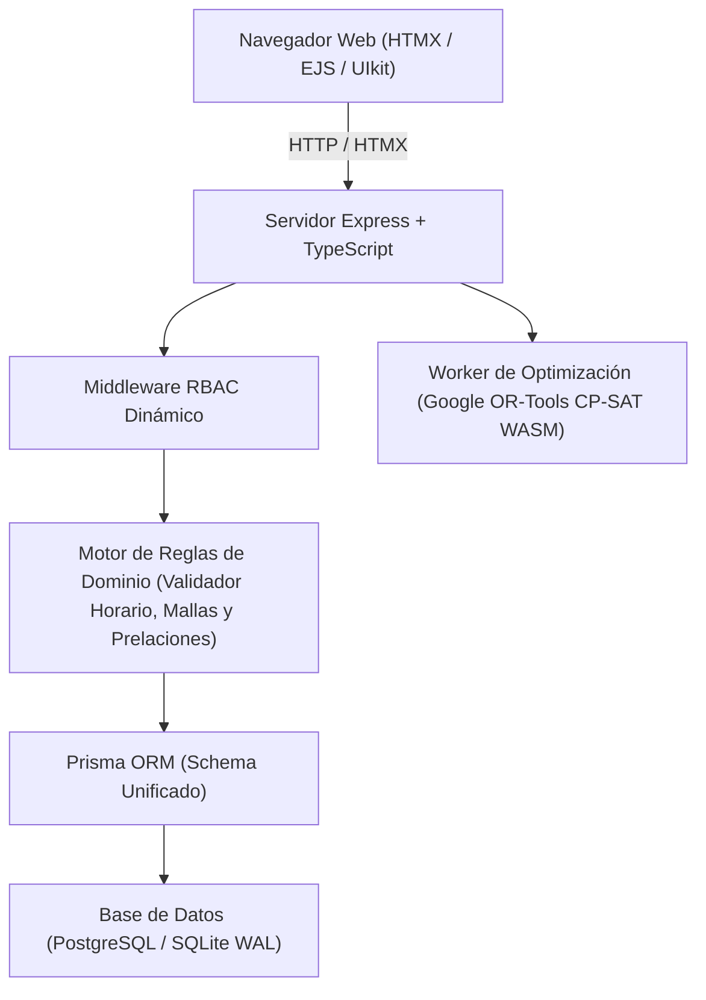

# Manual Técnico de Arquitectura y Desarrollo — SAHAD UBV
**Sistema Automatizado para la Asignación de Horarios Académicos de los Docentes**  
**Universidad Bolivariana de Venezuela (UBV) — Eje Geopolítico Regional Kerepakupai Vena**  
*Versión: 2.3 — Octubre 2026*

---

## 1. Arquitectura del Sistema y Pila Tecnológica

### 1.1 Stack Tecnológico
- **Entorno de Ejecución**: Node.js 22 LTS (fijado en `.nvmrc` y en `engines` de `package.json`). El motor CP-SAT (`or-tools-wasm`) usa el objeto global `navigator`, que Node incorpora desde la versión 21; en Node 20 falla con `navigator is not defined`.
- **Lenguaje**: TypeScript 5.6 con verificación estricta de tipos.
- **Framework Web**: Express 4.21 (Arquitectura modular MVC orientada al dominio).
- **Capa de Persistencia y ORM**: Prisma ORM 5.22.
  - Entorno de desarrollo: SQLite 3 con modo Write-Ahead Logging (`PRAGMA journal_mode = WAL;`) para concurrencia optimizada.
  - Entorno de producción: PostgreSQL 15+ con extensiones `uuid-ossp` y `btree_gist`.
- **Motor de Plantillas y SSR**: EJS con `express-ejs-layouts` y componentes modulares.
- **Interactividad Reactiva**: HTMX 1.9 para transiciones parciales sin recarga completa de página.
- **Diseño y Estilos**: CSS Modular Personalizado con Tokens institucionales UBV y UIkit 3.21.
- **Motor de Optimización Horaria**: Worker en segundo plano desacoplado con Google OR-Tools WebAssembly (`or-tools-wasm`).
- **Framework de Pruebas**: Vitest 5.0 (TDD/BDD con pruebas de reglas de dominio 100% reales).



---

## 2. Modelo de Datos Relacional (Prisma ORM)

### 2.1 Modelos Principales
- `ProgramaFormacion`: Catálogo de PFG (código, nombre, área de conocimiento).
- `UnidadCurricular`: Asignatura en la malla con trayecto, tramo, desglose de horas ($H_T, H_P, H_C$) y tipología de espacio.
- `UnidadCurricularPrelacion`: Relación autorreferencial de prelaciones curriculares directas (`unidadCurricularId`, `preladaPorId`).
- `Profesor` & `ProfesorDedicacion`: Información contractual del docente y límites normativos de dedicación (DE, TC, MT, TV).
- `ProfesorDisponibilidad`: Matriz semanal de disponibilidad declarada por el docente (franja horaria y prioridad P1/P2/P3).
- `Sede` & `EspacioFisico`: Infraestructura institucional (Ciudad Bolívar, aldeas municipalizadas, tipos de aula y aforo).
- `Seccion`: Oferta académica de una UC en un período, con turno (MATUTINO, VESPERTINO, NOCTURNO) y cupos.
- `HorarioSeccion`: Asignación horaria semanal de la sección en una franja y espacio físico determinado.
- `AuditoriaAjusteHorario`: Trazabilidad inmutable de cualquier creación, movimiento o supresión de bloques manuales.
- `AuditoriaDisponibilidad`: Historial de cada cambio real a la disponibilidad de un docente en un período (responsable, rol, resumen, franjas anteriores y nuevas en JSON y motivo, obligatorio cuando edita alguien distinto del docente). Se escribe en la misma transacción que reemplaza las franjas (Spec 06, sección 5).
- `UsuarioPrograma` (`usuarios_programas`): programas que coordina cada `COORDINADOR_PFG` (único por usuario y programa). El middleware `cargarAlcancePfg` lo lee en cada petición y deja `req.alcancePfg`; las reglas puras están en `src/core/domain/rules/alcancePfgRules.ts` (Spec 06, sección 4).

---

## 3. Catálogo de Restricciones del Dominio (Spec 01 y Spec 09)

### 3.1 Restricciones Duras de Horarios ($H$)
- **`H-01` No Solapamiento Docente**: Un profesor no puede dictar dos clases al mismo tiempo.
- **`H-02` No Solapamiento de Aula**: Un espacio físico no puede ser ocupado por dos secciones simultáneamente.
- **`H-03` No Solapamiento de Sección**: Una misma sección estudiantil no puede tener dos asignaturas al mismo tiempo.
- **`H-06` Respeto a la Disponibilidad Docente**: Bloqueo absoluto de asignación en franjas declaradas como no disponibles por el profesor.
- **`H-07` No Solapamiento de Prelaciones Curriculares**: Dos secciones de un mismo PFG y turno con relación de prelación directa no deben colisionar en franja horaria.
- **`H-08` Adecuación Espacial de Proyecto**: Unidades marcadas como Proyecto Comunitario no reservan aula física de campus (validador, matriz, motores genético y CP-SAT y evaluador).
- **`H-09` Antiteletransportación Inter-Sede**: Se impone un intervalo mínimo de 90 minutos para traslados físicos de docentes entre sedes o aldeas no colindantes.
- **`H-10` Integridad del bloque curricular**: Unidades en bloques continuos de 90 o 135 minutos.
- **`H-13` Reserva institucional de los martes**: Martes 10:45 AM–12:15 PM reservado; no se programa clase.
- **`H-14` Bloque fijo de Liderazgo**: Liderazgo I/II en bloques fijos de los jueves.
- **`H-ACCESIBILIDAD-PISO` / `H-DIAS-DISPONIBILIDAD`**: Piso máximo del docente vs nivel del aula; exactamente tres días hábiles acordados.

### 3.1.1 RBAC y privilegios operativos (Spec 06)

Roles vigentes: `ADMINISTRADOR`, `PLANIFICADOR` (alias legado `DIRECTOR_ACADEMICO` → mismo privilegio), `COORDINADOR_PFG`, `DOCENTE`.

| Capacidad | Dónde se aplica |
| :--- | :--- |
| Programación de matriz y solver | Solo Admin y Planificador (`ROLES_PROGRAMACION_HORARIOS` / `puedeProgramarHorarios`). El Coordinador ve la matriz en solo lectura. |
| Bitácora global `/auditoria` | Solo Admin (`AuditService` + `auditoriaRoutes`). |
| Toggles activar/desactivar (docentes, PFG, UC, espacios) | Solo Admin en rutas y en la UI (`usuario.rol === 'ADMINISTRADOR'`). |
| Disponibilidad de terceros | `permisoDisponibilidad`: Admin y Planificador (cualquier docente, motivo obligatorio); Coordinador (docentes de sus programas en el período, con motivo); Docente (solo la suya, sin motivo). |
| Prioridad de adscripción al asignar docente | `compararDocentesParaAsignacion` en `adscripcionRules.ts` y el picker de `secciones.ejs`: primero el profesor actual, luego adscritos al PFG de la UC, luego carga dentro de norma y nombre. |
| Ventana de oferta | `ofertaWorkflowRules.ts`: Coordinador escribe solo en *Borrador* / *Registro de Ofertas* / *Planificación*; fuera de esa ventana (salvo período cerrado) Admin y Planificador pueden ajustar. |

### 3.2 Reglas de Dominio Curricular ($RC$)
- **`RC-01` Unicidad**: Código de UC único por PFG.
- **`RC-02` Pertenencia Estricta**: Secciones solo pueden ofertar materias de su respectivo PFG.
- **`RC-03` Cómputo de Bloques**: Cantidad de horas lectivas semanales = $H_T + H_P$.
- **`RC-06` Correspondencia Biunívoca Trayecto-Tramo**: Cada Trayecto anual $T$ solo admite tramos $\{2T-1, 2T\}$.
- **`RC-07` Integridad de Prelaciones**: Prohibición de auto-prelación, validación de mismo PFG y exigencia de precedencia cronológica en la malla.

---

## 4. Estructura de Directorios

```
sahad/
├── docs/                      # Manuales de usuario y técnicos oficiales
│   ├── MANUAL_USUARIO.md
│   └── MANUAL_TECNICO.md
├── prisma/
│   ├── schema.prisma          # Esquema formal unificado Prisma ORM
│   └── dev.db                 # Base de datos SQLite local (WAL mode)
├── specs/                     # Especificaciones formales del sistema
├── src/
│   ├── core/                  # Núcleo del dominio y acceso a datos
│   │   ├── database/          # Cliente Prisma y configuración SQLite WAL
│   │   └── domain/            # Lógica pura de negocio, reglas y validadores
│   ├── modules/               # Módulos verticales por contexto acotado
│   │   ├── auth/              # Autenticación y sesiones
│   │   ├── curriculo/         # Mallas curriculares y prelaciones
│   │   ├── docentes/          # Gestión profesoral y disponibilidad
│   │   ├── espacios/          # Sedes y aulas físicas
│   │   ├── horarios/          # Matriz semanal, Drag & Drop y filtros PFG
│   │   ├── periodos/          # Períodos lectivos y secciones
│   │   ├── auditoria/         # Bitácora global (solo Administrador)
│   │   └── solver/            # Motor de optimización CP-SAT / genético
│   ├── public/                # Recursos estáticos (CSS modular, JS, SVG logos)
│   ├── server.ts              # Punto de entrada de la aplicación Express
│   └── views/                 # Plantillas EJS y componentes parciales
└── tests/                     # Suite de pruebas automatizadas con Vitest
    ├── acceptance/            # Pasos de la Spec 05 (un archivo por Regla)
    ├── auditoria/             # Acceso a la bitácora
    ├── database/              # Respaldo SQLite
    ├── domain/                # Pruebas reales de reglas de negocio
    ├── helpers/               # Base SQLite efímera, peticiones Express mínimas y fábricas
    ├── roles/                 # Permisos del Planificador y límites de toggles
    └── oferta/                # Importación, exportación e inconsistencias
```

---

## 5. Pruebas Automatizadas y Calidad de Código (TDD)
Conforme a la directriz `AGENTS.md`:
- Quedan terminantemente prohibidos los mocks de lógica de negocio o aserciones triviales.
- La suite se ejecuta con:
  ```bash
  pnpm test
  # o npx vitest run
  ```
- **Pruebas de aceptación (Spec 05)**: `pnpm test:acceptance` ejecuta `specs/05-acceptance-tests.feature` con `@amiceli/vitest-cucumber`. Cada `Regla:` lleva una etiqueta (`@dedicacion`, `@solapamiento`, `@traslado`, `@proyecto`, `@auditoria`, `@mallas`, `@oferta`, `@coordinador`) y su archivo `tests/acceptance/<etiqueta>.steps.test.ts`. El runner falla si un escenario no tiene implementación o si el texto de un paso no coincide.
  - Las reglas puras llaman directamente al validador, al motor genético y al evaluador. El motor CP-SAT tiene sus propias pruebas en `tests/domain/cpSatEngine.test.ts` (H-08, aula y docente ya ocupados, caso sin solución).
  - Las reglas con base de datos crean una SQLite efímera con `crearBaseTemporal()` (aplica `prisma db push`, apunta `DATABASE_URL` y `SAHAD_DIRECTORIO_RESPALDOS` a una carpeta temporal) y **después** importan los controladores con `await import(...)`. Solo se sustituye la capa HTTP (`peticion()` / `respuesta()` en `tests/helpers/peticiones.ts`); el alcance se calcula con el middleware real. `peticion()` detiene la prueba si el cliente Prisma global no apunta a la base temporal.
- Todas las pruebas deben arrojar 100% de éxito antes de cualquier entrega o despliegue.

---

## 6. Procedimiento de Instalación y Despliegue

### 6.1 Entorno local (desarrollo)

```bash
# 1. Clonar repositorio y entrar al directorio
cd sahad

# 2. Usar Node 22 LTS (lee .nvmrc) e instalar dependencias con pnpm
nvm install && nvm use
pnpm install

# 3. Configurar variables de entorno en .env
cp .env.example .env

# 4. Sincronizar esquema de base de datos
npx prisma db push

# 5. Cargar datos semilla iniciales
npx tsx src/scripts/seedAdmin.ts

# 6. Iniciar servidor de desarrollo
pnpm dev

# 7. Compilar (TypeScript no copia vistas ni estáticos)
pnpm build
cp -r src/views src/public dist/
pnpm start
```

### 6.2 Servidor de pruebas (staging)

Instancia operativa del Eje Kerepakupai Vena usada para validación previa a producción.

| Elemento | Valor |
|---|---|
| Acceso público | `http://185.193.66.108` |
| Código en el servidor | `/root/www/node/schaah` |
| Repositorio remoto | `https://github.com/jeancarlos1111/schaah.git` |
| Runtime | Node.js 22 + pnpm 10.33 |
| Persistencia | SQLite (`prisma/dev.db`, modo WAL) |
| Proceso | PM2, nombre `sahad` (`dist/server.js`, `--env-file=.env`) |
| Proxy HTTP | Nginx en el puerto 80 → `127.0.0.1:3000` (`client_max_body_size 20m` para Excel de oferta) |
| Firewall | Solo SSH (22) y HTTP (80); el puerto 3000 no es público |
| Arranque al reinicio | `pm2-root.service` (systemd) |

Variables en `/root/www/node/schaah/.env` (permisos `600`):

```bash
PORT=3000
NODE_ENV=staging
DATABASE_URL="file:./dev.db"
SESSION_SECRET="<aleatorio de openssl rand -hex 32>"
```

`NODE_ENV` debe ser `staging` mientras el sitio se sirva por HTTP sin TLS. Con `production`, Express marca la cookie de sesión como `secure` y el navegador no la guarda en HTTP plano, de modo que el inicio de sesión falla. Cuando exista dominio con HTTPS (`certbot --nginx`), pasar a `NODE_ENV=production`.

Tras `pnpm build` hay que copiar `src/views` y `src/public` a `dist/`: el compilador TypeScript no las incluye y el servidor las resuelve desde `__dirname` en `dist/`.

Comandos de operación habituales:

```bash
pm2 status
pm2 logs sahad
pm2 restart sahad --update-env
curl -fsS http://127.0.0.1:3000/health
curl -fsS http://185.193.66.108/health
```

### 6.3 Redespliegue desde GitHub

El script `/root/www/node/redesplegar-sahad.sh` actualiza el código en el servidor de pruebas sin tocar el `.env` (está en `.gitignore`). La base `prisma/dev.db` se **respalda** y luego se **alinea al `schema.prisma`** con `prisma db push` (sin borrar datos). Debe ejecutarse como `root` en el servidor:

```bash
/root/www/node/redesplegar-sahad.sh
```

Secuencia que ejecuta:

1. Respaldo de la base con `pnpm db:respaldo` (queda en `backups/`).
2. `git pull --ff-only` desde `origin/main`.
3. `pnpm install --frozen-lockfile`, `pnpm prisma:generate`, `pnpm exec prisma db push` y `pnpm build`.
4. Copia de `src/views` y `src/public` a `dist/`.
5. `pm2 restart sahad --update-env`, `pm2 save` y comprobación de `/health`.

Si el código nuevo consulta tablas o columnas que aún no existen en SQLite (p. ej. `usuarios_programas`, `centros_estudio`, `bitacora_auditoria`), los listados responden **500**. Tras un pull con cambios de esquema hay que aplicar `prisma db push` (el script de redespliegue ya lo incluye). Opcionalmente, `pnpm seed` actualiza roles/permisos canónicos (Planificador, etc.) sin recrear la base.

Contenido de referencia del script:

```bash
#!/usr/bin/env bash
# Actualiza SAHAD-UBV desde GitHub y reinicia el proceso PM2 "sahad".
# El .env no se toca. La base se respalda y se alinea al schema.prisma.
set -euo pipefail
cd /root/www/node/schaah
export COREPACK_ENABLE_DOWNLOAD_PROMPT=0 CI=true

pnpm db:respaldo
git pull --ff-only
pnpm install --frozen-lockfile
pnpm prisma:generate
pnpm exec prisma db push
pnpm build
rm -rf dist/views dist/public
cp -r src/views src/public dist/
pm2 restart sahad --update-env
pm2 save
sleep 3
curl -fsS http://127.0.0.1:3000/health && echo
```

Flujo recomendado desde el puesto de desarrollo:

1. Commit y `git push` a `main` en GitHub.
2. En el servidor: `/root/www/node/redesplegar-sahad.sh`.
3. Verificar login y una matriz de horarios en `http://185.193.66.108`.

Para restaurar un respaldo: detener el proceso (`pm2 stop sahad`), copiar el archivo de `backups/` sobre `prisma/dev.db`, eliminar `prisma/dev.db-wal` y `prisma/dev.db-shm` si existen, y `pm2 start sahad`.

---

## 7. Manual de Usuario y sus Capturas

`docs/MANUAL_USUARIO.md` (v3.5) es la única fuente del manual de usuario; este documento técnico va en v2.3. La ruta `/ayuda/manual-usuario` lo convierte a HTML con `marked` (`src/modules/ayuda/manualRenderer.ts`: índice a partir de los encabezados de nivel 2 y 3, capturas con la clase `.manual-captura`, tablas con `.clean-table`) y publica `docs/img` bajo `/ayuda/img`, de modo que las rutas relativas `img/manual/NN-modulo-accion.png` funcionan igual en el repositorio y en el sistema. El recorrido `pnpm manual:capturas` inicia sesión con cada rol: Admin (usuarios, auditoría, docentes con Suspender), Planificador (catálogos, oferta, solver, matriz editable), Coordinador (tablero, mallas, oferta y matriz solo lectura) y Docente (tablero, disponibilidad y su horario).

Para regenerar las capturas sin tocar `prisma/dev.db`:

```bash
# 1. Copia de dev.db en prisma/demo-manual.db con datos de demostración del período 2026-II y PFG-INFO:
#    disponibilidad de sus docentes, una sección para carlos.gomez y las aulas teóricas que falten.
pnpm manual:demo

# 2. Servidor sobre la copia, en el puerto que esperan las capturas (SAHAD_URL lo cambia)
DATABASE_URL="file:./demo-manual.db" PORT=3999 pnpm dev

# 3. Recorrido por rol con Chrome sin interfaz (CHROME_BIN lo cambia); escribe docs/img/manual/*.png.
#    Requiere pdftoppm para la página del PDF y el libro de oferta CONSOLIDADO*.xlsx en la raíz
#    (o SAHAD_LIBRO_OFERTA).
pnpm manual:capturas
```

- `seedDemoManual.ts` rechaza como destino `dev.db` o la propia base de origen (`verificarDestinoDemo`), y `capturasManual.ts` aborta si el servidor no está sobre la base demo o si 2026-II ya tiene horarios (en ese caso, repetir el paso 1).
- Cada captura nueva debe referenciarse en el manual con su pie `*Figura N. ...*`: `tests/ayuda/manualUsuario.test.ts` falla si hay imágenes huérfanas o inexistentes, figuras fuera de orden o falta el flujo de algún rol.
- `prisma/demo-manual.db` es desechable; bórrela al terminar.
