# Manual de Usuario — SAHAD UBV

**Sistema Automatizado para la Asignación de Horarios Académicos de los Docentes**  
**Universidad Bolivariana de Venezuela (UBV) — Eje Geopolítico Regional Kerepakupai Vena**  
*Versión 3.5 — Octubre 2026*

Este manual explica cada parte del sistema y el orden correcto de trabajo para cada rol de usuario. Cada sección incluye una captura de pantalla real del sistema; las capturas se tomaron con datos de demostración del período **2026-II** y el programa **Informática para la Gestión Social (PFG-INFO)**, por lo que las cifras de su institución serán distintas.

---

## 1. Introducción y conceptos

### 1.1 Propósito del sistema

SAHAD es la plataforma oficial de la UBV para planificar la carga lectiva de los docentes, distribuir las clases en la semana y controlar el uso de aulas y laboratorios del Eje Kerepakupai Vena. Reúne en un solo lugar la oferta de carga horaria, las mallas curriculares, la nómina docente, las sedes y aulas, y la matriz semanal de horarios, y valida automáticamente que ningún horario viole las normas institucionales.

### 1.2 Conceptos clave

| Concepto | Qué significa en el sistema |
| :--- | :--- |
| **Período académico** | Lapso semestral (ej. `2026-II`) con fecha de inicio y culminación. Sus fases incluyen *Borrador*, *Registro de Ofertas*, *Planificación*, *Oferta Aprobada*, *Activo* / *Publicada* y *Cerrado*. |
| **Ventana de oferta** | Fase en la que los Coordinadores de PFG pueden crear o editar secciones y asignar docentes: *Borrador*, *Registro de Ofertas* y *Planificación*. Fuera de esa ventana solo Administrador y Planificador pueden ajustar la oferta; un período *Cerrado* es inmutable. |
| **Programa de formación (PFG)** | Carrera o programa (PFG, PNF, PIU, PFA o IDIOMAS). Cada unidad curricular pertenece a un programa. |
| **Unidad curricular (UC)** | Materia de la malla, con sus horas teóricas (HT), prácticas (HP) y de campo (HC). |
| **Sección o cohorte** | Grupo de estudiantes de un programa en un período, con sede, turno y matrícula (ej. `KV-BO-RC-01-A-M`). |
| **Asignación UC** | Una unidad curricular dictada por un docente dentro de una cohorte. Es lo que se programa en la matriz. |
| **Bloque académico** | Franja oficial de 90 minutos (2 horas académicas de 45 min). Hay 8 bloques por día, de lunes a sábado: 3 matutinos, 3 vespertinos y 2 nocturnos. |
| **Disponibilidad docente** | Franjas que el docente declara como disponibles (con prioridad alta, media o baja) para un período. |
| **PFG de adscripción** | Programa al que el docente está adscrito con prioridad al asignar carga. |
| **Tres días acordados** | Exactamente tres días hábiles en los que el docente puede dictar clases; el sistema no programa fuera de esos días. |
| **Piso máximo** | Límite de accesibilidad del docente (0 = planta baja … 3). El aula tiene un *nivel de piso*; no se asigna un aula por encima del máximo del docente. |
| **Dedicación** | Régimen contractual del docente, que fija sus horas mínimas y máximas de docencia directa semanal. |
| **Oferta de carga horaria** | Libro Excel institucional con las cohortes, unidades curriculares y docentes del período. |

Los límites de docencia directa semanal que el sistema aplica son:

| Dedicación | Mínimo | Máximo |
| :--- | :---: | :---: |
| Dedicación Exclusiva (DE) | 12 h | 16 h |
| Tiempo Completo (TC) | 8 h | 12 h |
| Medio Tiempo (MT) | 4 h | 8 h |
| Tiempo Convencional (TV) | 2 h | 12 h |

---

## 2. Acceso y elementos comunes

### 2.1 Inicio de sesión

1. Abra la dirección del sistema en el navegador (por ejemplo, `http://localhost:3000` o el dominio institucional).
2. Escriba su correo institucional (`@ubv.edu.ve`) y su contraseña.
3. Pulse **Iniciar Sesión**. Si los datos no coinciden, el sistema muestra *"Credenciales inválidas"* sin indicar cuál de los dos campos falló.

La sesión dura una jornada laboral (8 horas). Para salir, pulse **Salir** en la esquina superior derecha. Cada inicio de sesión exitoso queda registrado en la bitácora de auditoría (solo visible para el Administrador).

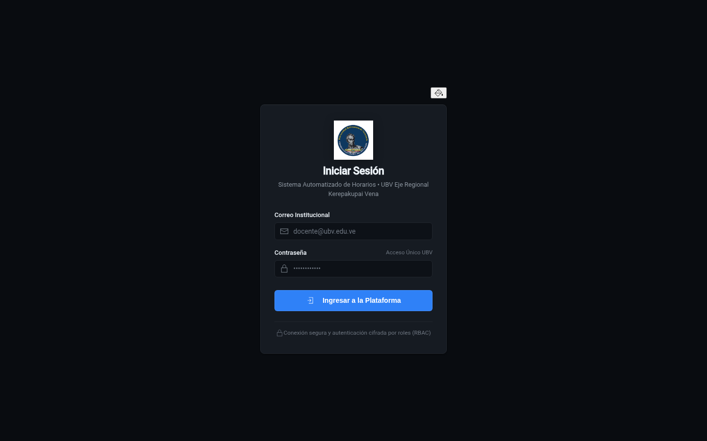
*Figura 1. Pantalla de inicio de sesión.*

### 2.2 Barra de navegación

La barra superior muestra solo los módulos que su rol puede usar. A la derecha están el botón de ayuda (**?**), el botón para cambiar de tema, su nombre con el rol asignado y el botón **Salir**. La figura muestra la barra completa del Administrador; el menú de cada rol se describe en la sección 3.

*Figura 2. Barra de navegación con todos los módulos (rol Administrador), incluida Auditoría.*

### 2.3 Tablero de control

Es la primera pantalla después de iniciar sesión. **Todos los roles** ven las mismas cuatro métricas institucionales del período vigente: nómina docente, oferta de secciones (porcentaje con docente), espacios académicos y cumplimiento legal (sobrecarga H-04 / déficit H-05). El período vigente se indica junto a *Planificación Académica*: el de *Planificación* o *Borrador* más reciente o, si no hay ninguno, el *Activo* más reciente. Los cerrados no cuentan; si no hay período abierto, aparece *"Sin período abierto"* y cifras en cero.

Debajo, las tarjetas de **Módulos del Sistema** cambian según el rol: la planificación ve accesos a matriz, disponibilidad, infraestructura y normativa; el Docente ve accesos a **su horario**, **su disponibilidad** y **normativa**. El botón **Matriz de Horarios** (o **Mi Horario**) abre la matriz del período vigente con el alcance de su rol.

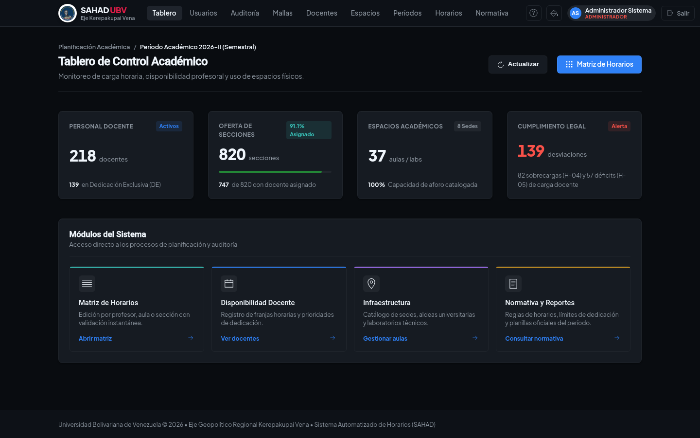
*Figura 3. Tablero de control (métricas institucionales; los accesos inferiores dependen del rol).*

### 2.4 Ayuda en línea

El botón **?** abre el Centro de Ayuda en Línea desde cualquier pantalla. Tiene pestañas con el uso de la matriz (quién puede programar y quién solo consulta), las prelaciones y mallas, la tabla de dedicación docente y el acceso a los manuales. También muestra el código de colores de los bloques: azul para docencia en aula, naranja para proyecto comunitario y rojo para conflictos.

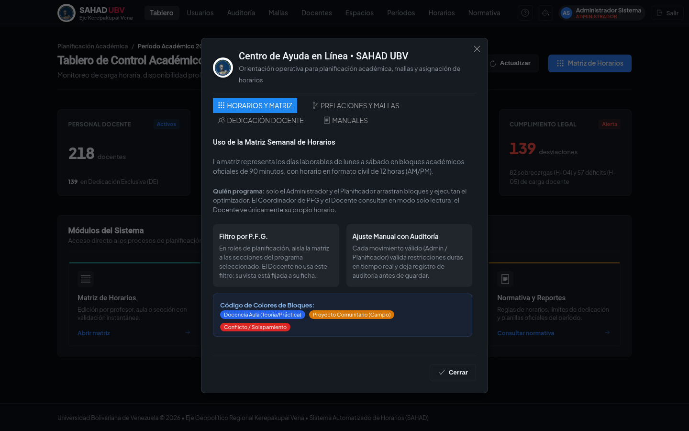
*Figura 4. Centro de Ayuda en Línea.*

### 2.5 Tema claro u oscuro

El botón con el icono de balde de pintura alterna entre el tema oscuro y el claro. La preferencia queda guardada en el navegador.

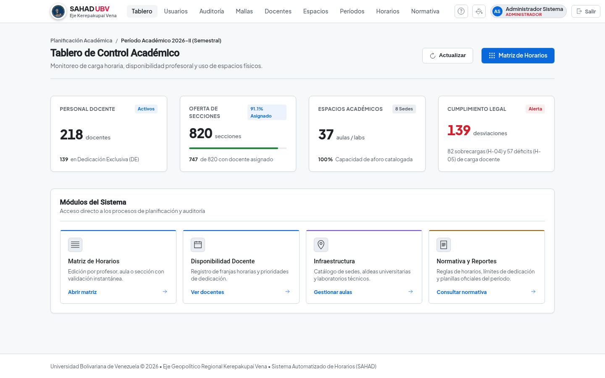
*Figura 5. El mismo tablero en tema claro.*

### 2.6 Tablas, búsqueda y filtros

Todos los listados funcionan igual:

- **Buscar**: el cuadro de búsqueda filtra mientras escribe.
- **Filtros**: las listas desplegables bajo el buscador (programa, sede, estado, etc.) se combinan entre sí. **Limpiar** los quita todos.
- **Ordenar**: pulse el título de una columna con flechas para ordenar; púlselo otra vez para invertir el orden.
- **Filas y páginas**: elija cuántas filas ver en **Filas** y navegue con los botones de página al pie de la tabla.
- **Acciones**: los botones de cada fila (Editar, Desactivar, Disponibilidad, etc.) están siempre a la derecha.

---

## 3. Roles y permisos

El sistema tiene cuatro roles. Lo que cada uno puede hacer es lo siguiente (✅ permitido, 👁️ solo consulta, ❌ no disponible):

| Acción | Administrador | Planificador | Coordinador de PFG | Docente |
| :--- | :---: | :---: | :---: | :---: |
| Gestionar usuarios y roles | ✅ | ❌ | ❌ | ❌ |
| Consultar la bitácora de auditoría global | ✅ | ❌ | ❌ | ❌ |
| Activar o desactivar registros (toggles) | ✅ | ❌ | ❌ | ❌ |
| Configurar sedes y aulas | ✅ | ✅ sin toggle | 👁️ | ❌ |
| Crear períodos y cambiar su fase (aprobar / publicar) | ✅ | ✅ | ❌ | ❌ |
| Crear o editar programas de formación | ✅ | ✅ sin toggle | ❌ | ❌ |
| Gestionar unidades curriculares (malla) | ✅ | ✅ sin toggle | ✅ sus programas | ❌ |
| Crear secciones y asignaciones | ✅ salvo *Cerrado* | ✅ salvo *Cerrado* | ✅ sus programas (ventana abierta) | ❌ |
| Eliminar asignaciones | ✅ salvo *Cerrado* | ✅ salvo *Cerrado* | ✅ sus programas (ventana abierta) | ❌ |
| Asignar o cambiar el docente de una asignación | ✅ salvo *Cerrado* | ✅ salvo *Cerrado* | ✅ sus programas (ventana abierta) | ❌ |
| Importar la oferta de carga horaria (.xlsx) | ✅ | ✅ | ❌ | ❌ |
| Ver y exportar la oferta (.xlsx) | ✅ | ✅ | ✅ sus programas | 👁️ descarga del período |
| Ver inconsistencias de la oferta | ✅ | ✅ | ✅ sus programas | ❌ |
| Confirmar códigos provisionales de UC | ✅ | ✅ | ✅ sus programas | ❌ |
| Ejecutar y aplicar el optimizador (solver) | ✅ | ✅ | ❌ | ❌ |
| Ajustar horarios a mano (arrastrar y soltar) | ✅ | ✅ | 👁️ solo lectura | ❌ |
| Registrar y editar docentes de la nómina | ✅ | ✅ | ✅ | ❌ |
| Registrar disponibilidad horaria | ✅ cualquier docente, con motivo | ✅ cualquier docente, con motivo | ✅ docentes de sus programas, con motivo | ✅ solo la suya |
| Consultar el historial de cambios de la disponibilidad | ✅ | ✅ | ✅ docentes de sus programas | ✅ el suyo |
| Consultar horarios en la matriz | ✅ todos | ✅ todos | ✅ sus programas | 👁️ **solo su propio horario** |
| Consultar períodos y asignaciones del período | ✅ | ✅ | ✅ sus programas | ❌ (redirige a su horario) |
| Planilla consolidada de carga docente | ✅ | ✅ | ✅ sus programas | ❌ |
| Consultar la normativa y descargar reportes | ✅ | ✅ | ✅ | 👁️ su horario, su disponibilidad y la oferta .xlsx |

"Sus programas" son los programas que el Administrador vinculó al coordinador (sección 5.1). **Ventana abierta** = período en *Borrador*, *Registro de Ofertas* o *Planificación*. Fuera de esa ventana (salvo período *Cerrado*), Administrador y Planificador siguen pudiendo ajustar la oferta; el Coordinador no. Si alguien intenta una acción fuera de su rol o de sus programas, el sistema responde *"Acceso denegado"* y no guarda nada.

El rol de planificación en la interfaz aparece como **Planificador** (`PLANIFICADOR`). Cuentas antiguas etiquetadas como Dirección Académica se tratan con el mismo privilegio.

**Menú por rol:**

- **Administrador**: Tablero, Usuarios, **Auditoría**, Mallas, Docentes, Espacios, Períodos, Horarios y Normativa (figura 2).
- **Planificador** y **Coordinador de PFG**: los mismos módulos excepto Usuarios y Auditoría.
- **Docente**: Tablero, Mi Disponibilidad, Horarios y Normativa.

*Figura 6. Menú del Planificador (sin Usuarios ni Auditoría).*

*Figura 7. Menú del Coordinador de PFG.*

*Figura 8. Menú del Docente.*

---

## 4. Flujo correcto por rol

Esta sección indica en qué orden conviene trabajar. El detalle de cada pantalla está en la sección 5. Las capturas de esta sección se tomaron con la cuenta de cada rol.

### 4.1 Administrador (`ADMINISTRADOR`)

El Administrador prepara la plataforma para que los demás roles puedan trabajar:

1. **Crear las cuentas** de planificadores, coordinadores y docentes en **Usuarios → Nuevo Usuario** (5.1).
2. **Vincular a cada coordinador con sus programas** al crear o editar su cuenta. Sin al menos un programa, el sistema no permite guardar al coordinador.

   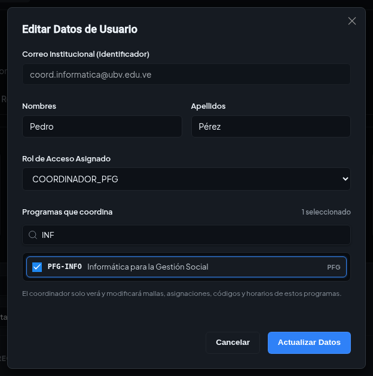
   *Figura 9. Edición de un coordinador con el buscador de programas filtrado por "INF".*

3. **Revisar la matriz de permisos** en **Usuarios → Matriz de Roles y Permisos** si la institución necesita ajustar privilegios.
4. **Consultar la bitácora** en **Auditoría** cuando haga falta rastrear un cambio o un inicio de sesión (5.1.4).
5. **Cargar o revisar sedes y aulas** en **Espacios** (5.4), si el Planificador no lo ha hecho. Solo el Administrador puede **Desactivar** registros.
6. **Atender incidencias de cuentas**: restablecer contraseñas (**Clave**) y desactivar o reactivar accesos. El sistema impide que el Administrador se desactive a sí mismo.

Además, el Administrador puede realizar cualquier tarea del Planificador y registrar la disponibilidad de cualquier docente cuando este no pueda hacerlo, indicando el motivo (5.3.4). En la nómina docente solo él ve **Suspender** / **Activar**:

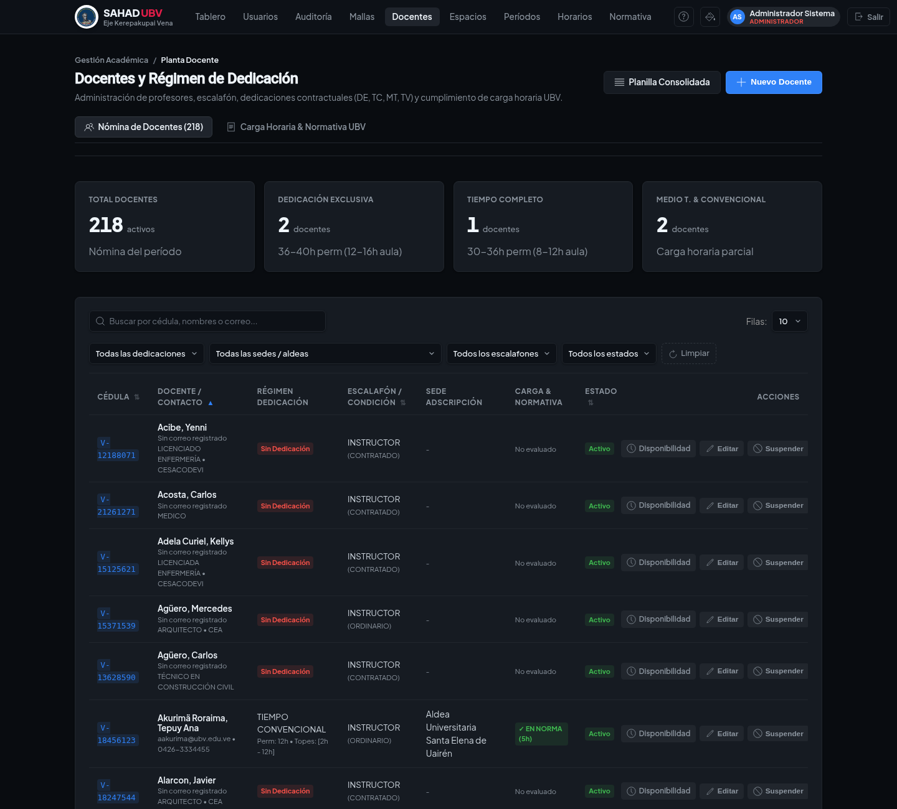
*Figura 10. Nómina vista por el Administrador: incluye Suspender/Activar en cada fila.*

### 4.2 Planificador (`PLANIFICADOR`)

El Planificador conduce la planificación y la asignación de aulas y horarios de cada período. **No** ve **Usuarios** ni la bitácora de **Auditoría**, y **no** puede activar ni desactivar docentes, aulas, sedes, programas ni unidades (esos botones solo los ve el Administrador). Sí puede crear y editar catálogos, abrir la ventana de ofertas, revisar o corregir la disponibilidad de cualquier docente (con motivo) y programar la matriz.

*Figura 11. Tablero del Planificador: mismas métricas institucionales; accesos a matriz, disponibilidad, infraestructura y normativa (sin Usuarios ni Auditoría).*

1. **Preparar el catálogo**: programas y mallas en **Mallas** (5.2), sedes y aulas en **Espacios** (5.4), y la nómina con su dedicación, programa de adscripción, tres días acordados y restricción de piso en **Docentes** (5.3). En su nómina aparecen **Disponibilidad** y **Editar**, no Suspender.
2. **Aperturar el período** en **Períodos → Aperturar Período**, pasando por el checklist de prerrequisitos (al menos 1 docente activo, 1 aula activa y 1 unidad curricular activa) hacia *Registro de Ofertas* / *Planificación* (5.5).
3. **Importar y consolidar la oferta**: importar el archivo institucional (.xlsx), revisar las inconsistencias (sobrecargas, subcargas, vacantes) y coordinar con los Coordinadores de PFG (5.6). También puede ajustar la disponibilidad de un docente desde **Docentes → Disponibilidad** cuando este no pueda hacerlo (5.3.4).
4. **Cerrar la ventana de oferta** (pasar a *Oferta Aprobada* cuando corresponda) y **ejecutar el optimizador Solver** (5.7.3) para asignar **aulas físicas**, turnos y franjas respetando las restricciones duras (H-01 a H-14), la reserva de los martes (H-13) y los bloques fijos de Liderazgo (H-14). El aula concreta no se elige al crear la sección: se fija en la matriz o con el solver.
5. **Ajustes manuales y publicación**: realizar ajustes finos en la matriz mediante arrastrar y soltar (5.7), descargar horarios oficiales en PDF y pasar el período a fase *Activo* para publicar los horarios definitivos.

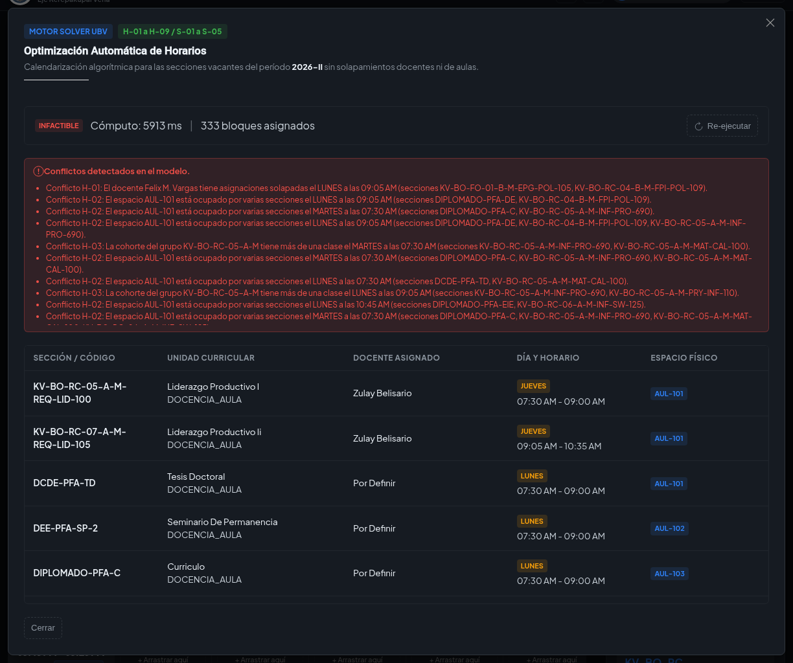
*Figura 12. Si otros programas aún no tienen disponibilidad declarada, el optimizador del Planificador sobre todo el período resulta infactible; cada conflicto nombra la sección y el docente afectados (ver 5.7.3).*

### 4.3 Coordinador de PFG (`COORDINADOR_PFG`)

El Coordinador gestiona la oferta académica y docencia de sus programas asignados. Su tablero y listados vienen filtrados automáticamente:

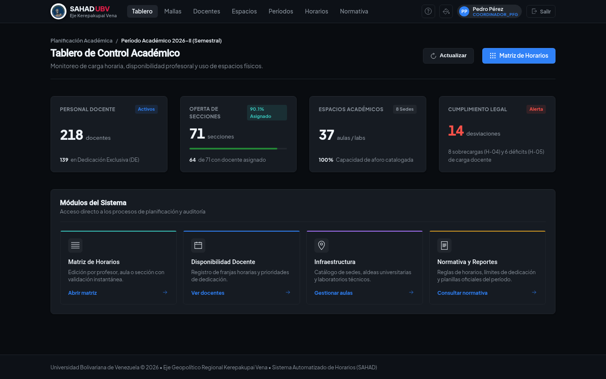
*Figura 13. Tablero del Coordinador: la oferta de secciones muestra solo las de sus programas.*

1. **Revisar la malla y unidades curriculares** de su programa en **Mallas** y registrar las unidades curriculares que falten (el tipo de espacio requerido queda en la UC; el aula física la asigna después el Planificador).
2. **Cargar la oferta de secciones durante la ventana abierta**: en **Períodos → Secciones**, registrar cohortes, cupos estimados y turnos. Esta carga solo es permitida mientras el período esté en *Borrador*, *Registro de Ofertas* o *Planificación*.
3. **Asignar docentes respetando adscripción y 3 días**: con **Cambiar Prof.**, la lista prioriza a los docentes **adscritos al programa** de la unidad, muestra horas disponibles, piso y días acordados, y rechaza asignaciones que excedan el tope de dedicación (H-04) o violen los tres días.
4. **Verificar disponibilidad**: verificar que los docentes de sus secciones hayan acordado sus 3 días (en la ficha, no los define el propio docente) y cargado franjas P1/P2/P3 en **Docentes → Disponibilidad**.
5. **Consulta de horarios en modo lectura**: una vez que el Planificador aprueba la oferta y asigna aulas y franjas (matriz o solver), el Coordinador consulta la matriz en modo solo lectura (sin arrastrar ni optimizar) y descarga los horarios en PDF de sus secciones y docentes.

En **Espacios** solo puede consultar; los botones de gestión no aparecen. Tampoco puede activar ni desactivar docentes, aulas ni programas, ni ejecutar el optimizador.

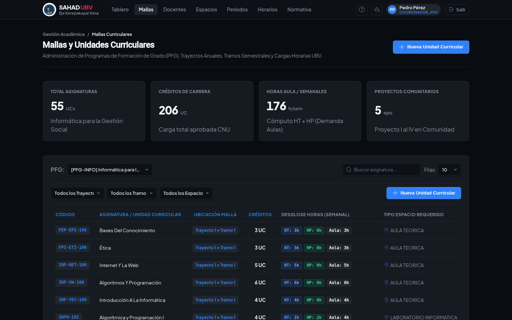
*Figura 14. Mallas desde la cuenta del Coordinador: solo aparece su programa y no hay botón para crear programas.*

### 4.4 Docente (`DOCENTE`)

El Docente participa activamente en el ciclo académico. Su menú es **Tablero**, **Mi Disponibilidad**, **Horarios** y **Normativa** (no ve Usuarios, Auditoría, Mallas, Docentes, Espacios ni Períodos).

1. **Acuerdo de días y disponibilidad**: acuerda sus tres (3) días laborables con su coordinación de adscripción (los registra Admin, Planificador o Coordinador en la ficha del docente) y declara sus **franjas** P1/P2/P3 en **Mi Disponibilidad**. En la cabecera de esa pantalla puede ver su PFG de adscripción, sus días acordados y su restricción de piso si están registrados.
2. **Consulta y descarga de horario oficial**: en **Horarios** ve **únicamente su propio horario** semanal (modo solo consulta) y lo descarga en PDF con formato civil venezolano de 12 horas (AM/PM).
3. **Normativa y reportes propios**: en **Normativa** consulta el catálogo de reglas (H-01 a H-14) y puede abrir **Mi horario**, **Mi disponibilidad** y descargar la **oferta de carga horaria (.xlsx)** del período vigente. No ve la planilla consolidada ni el reporte de inconsistencias.

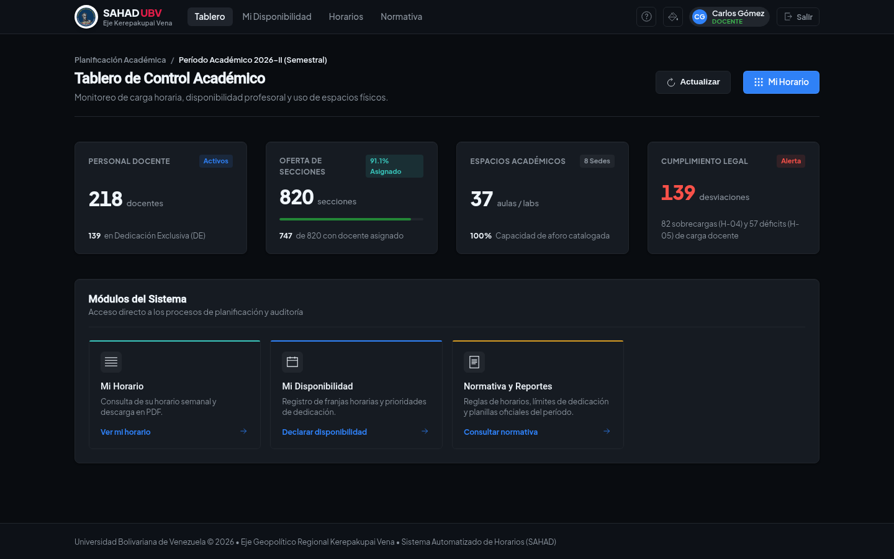
*Figura 15. Tablero del Docente: arriba, las mismas métricas institucionales del período; abajo, accesos a su horario, su disponibilidad y la normativa.*

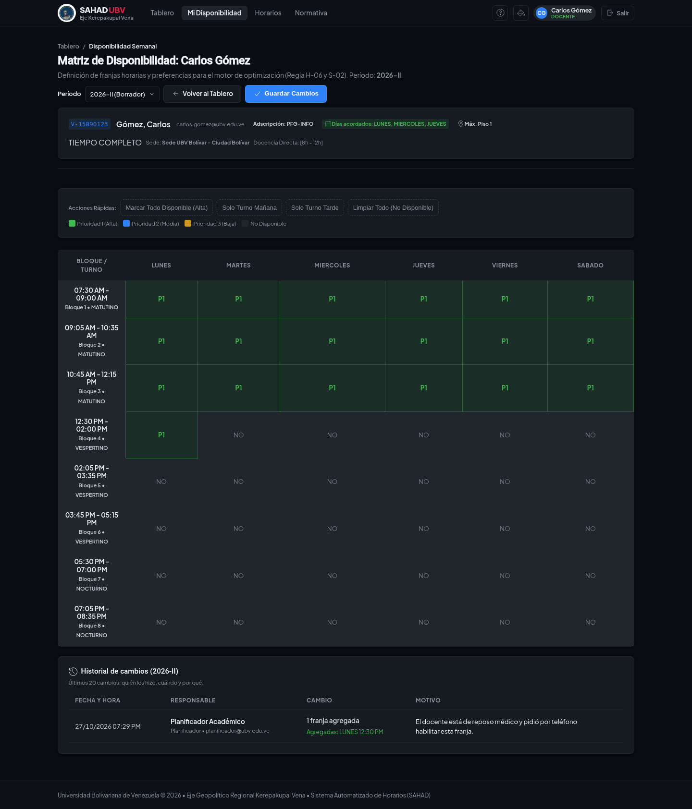
*Figura 16. Matriz de disponibilidad del Docente, con PFG de adscripción, días acordados, selector de período e historial de cambios.*

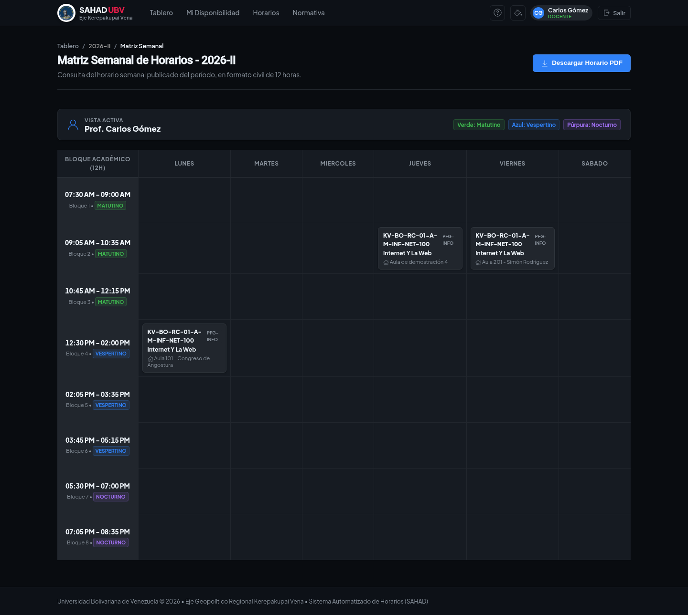
*Figura 17. Matriz del Docente: solo su horario, sin pestañas de perspectiva, sin solver y sin bandeja Por Programar; únicamente Descargar Horario PDF.*

**Restricción de la matriz (comportamiento actual del sistema):** la vista es de **solo consulta** y fuerza la perspectiva *Por Docente* con su propia ficha. No aparecen el optimizador, la bandeja *Por Programar*, los botones para quitar bloques, las tarjetas arrastrables, las pestañas de perspectiva, el selector de docente ni el filtro de programa. Si intenta abrir el horario de un aula, una cohorte u otro docente, el sistema vuelve a su horario con el aviso *"Solo puede consultar su propio horario."* Si abre **Períodos** o las asignaciones de un período, el sistema lo lleva a su horario con un aviso.

---

## 5. Módulos del sistema

### 5.1 Usuarios, roles y auditoría (Administrador)

#### 5.1.1 Cuentas de usuario

**Usuarios → Cuentas de Usuarios** lista todas las cuentas con su correo, rol, estado y fecha de creación. En los coordinadores, bajo el rol aparecen los códigos de sus programas. Cada fila tiene las acciones **Editar**, **Clave** (restablecer contraseña) y **Desactivar** o **Activar**.

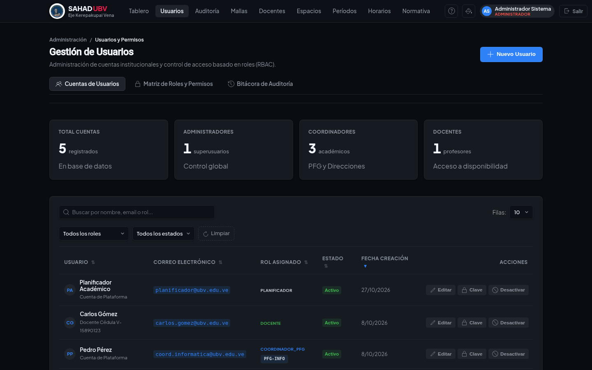
*Figura 18. Gestión de usuarios.*

Para crear una cuenta, pulse **Nuevo Usuario**, complete correo, nombres, apellidos, contraseña inicial y rol, y pulse guardar. Si el rol es Docente, vincule la cuenta con su ficha en la nómina docente. El rol de planificación se elige como **PLANIFICADOR**.

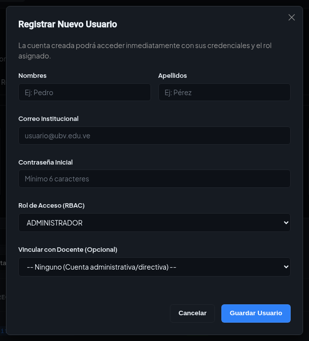
*Figura 19. Formulario de nuevo usuario.*

#### 5.1.2 Programas que coordina

Al elegir el rol **COORDINADOR_PFG** aparece el selector **Programas que coordina** (figura 9). Escriba parte del código o nombre en el buscador y marque uno o varios programas; el contador indica cuántos eligió. Es obligatorio elegir al menos uno. Los cambios aplican de inmediato, sin que el coordinador tenga que volver a iniciar sesión.

#### 5.1.3 Matriz de roles y permisos

**Usuarios → Matriz de Roles y Permisos** muestra los cuatro roles del sistema y una tabla con los privilegios por módulo. Marque o desmarque casillas y pulse **Guardar Cambios en Matriz**. El Administrador siempre conserva el acceso total.

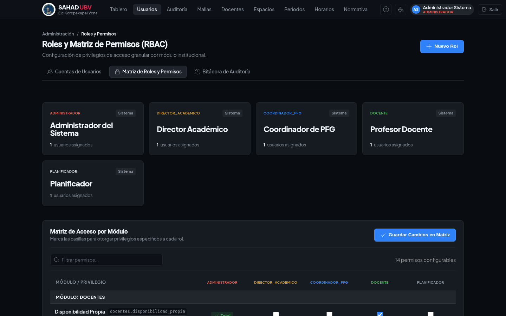
*Figura 20. Roles y matriz de permisos.*

#### 5.1.4 Bitácora de auditoría

**Auditoría** (también desde las pestañas de Usuarios y Roles) muestra el historial global e inmutable de eventos del sistema: creaciones, ediciones, eliminaciones, activaciones, desactivaciones, inicios de sesión, importaciones y ejecuciones del solver. Puede filtrar por entidad (usuario, rol, espacio, docente, sección, horario, período, malla, oferta, disponibilidad), por acción, por texto libre y por rango de fechas.

Solo el Administrador entra a esta pantalla; los demás roles reciben acceso denegado.

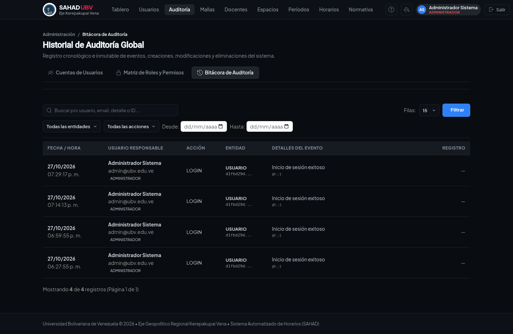
*Figura 21. Historial de Auditoría Global con filtros por entidad y acción.*

### 5.2 Mallas curriculares (`/curriculo`)

La pantalla muestra la malla del programa elegido en el selector **PFG**: total de unidades curriculares, créditos, horas de aula semanales y proyectos comunitarios. La tabla indica para cada unidad su ubicación (trayecto y tramo), créditos, horas y tipo de espacio requerido. Puede filtrar por trayecto, tramo y tipo de espacio.

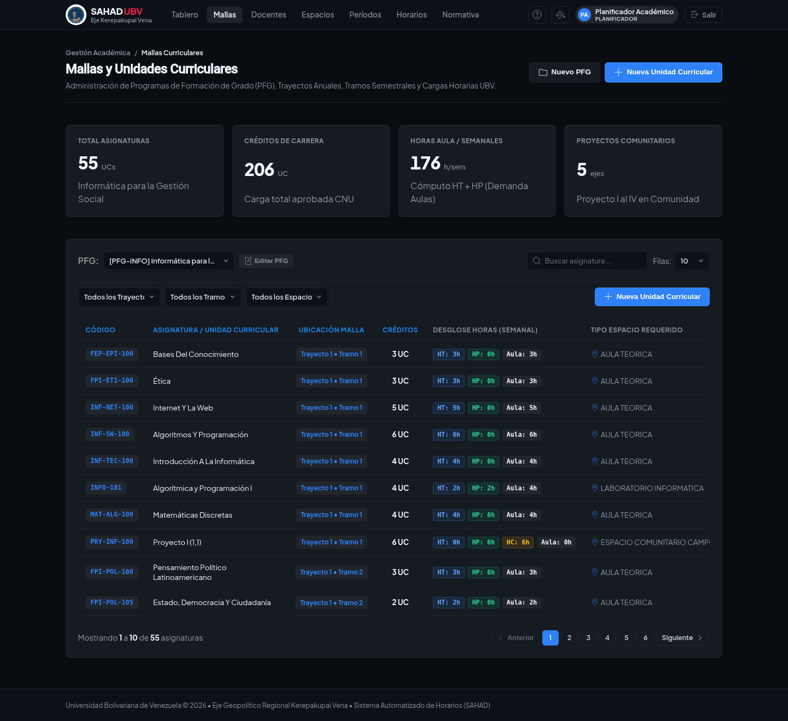
*Figura 22. Malla del PFG Informática para la Gestión Social.*

**Programas**: el Administrador y el Planificador crean programas con **Nuevo PFG** y los modifican con **Editar PFG**. Solo el Administrador puede **Desactivar** un programa.

**Unidades curriculares**: pulse **Nueva Unidad Curricular** y complete:

1. **Código y nombre** de la unidad, y sus **créditos**.
2. **Trayecto y tramo**. En los programas por trayectos (PFG, PNF y PIU) se respeta la correspondencia oficial: Trayecto Inicial con tramos 0 y 1; Trayecto I con tramos 1 y 2; Trayecto II con 3 y 4; Trayecto III con 5 y 6; Trayecto IV con 7 y 8; Trayecto V con 9 y 10. Los programas por cohortes (PFA e IDIOMAS) usan *Sin trayecto* y *Sin tramo*; si indica uno de los dos, debe indicar ambos.
3. **Distribución horaria**: HT (teóricas) y HP (prácticas) suman las horas de aula, que el sistema convierte en bloques de 90 minutos por semana. HC (campo comunitario) cuenta para la dedicación del docente pero no ocupa aula.
4. **Tipo de espacio requerido** (aula teórica, laboratorio, etc.) y si es **Proyecto Comunitario**.
5. **Prelaciones**: el selector lista solo las unidades del mismo programa ubicadas en un trayecto o tramo anterior. Si cambia el trayecto o tramo, las prelaciones que dejen de ser anteriores se marcan con *"No es anterior: se descartará"*. El sistema no permite mover una unidad a un tramo igual o posterior al de las unidades que la tienen como prelación.

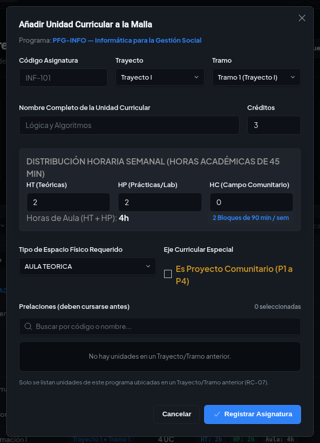
*Figura 23. Registro de una unidad curricular.*

Si una unidad llegó desde la oferta sin trayecto o tramo, al editarla verá un aviso amarillo y el formulario propondrá el primer tramo válido; revíselo antes de guardar. El filtro **Trayecto → Sin trayecto** lista esas unidades.

### 5.3 Docentes (`/docentes`)

#### 5.3.1 Nómina de docentes

Lista a los docentes con su cédula, contacto, dedicación, escalafón, sede de adscripción, indicadores de piso y días acordados, estado de carga y estado. Las tarjetas superiores resumen cuántos hay por dedicación. Cada fila tiene las acciones **Disponibilidad**, **Editar** y, solo para el Administrador, **Suspender** / desactivar (figura 10). Un docente marcado *Sin Dedicación* no tiene régimen contractual registrado para el período, por lo que no se puede evaluar su carga.

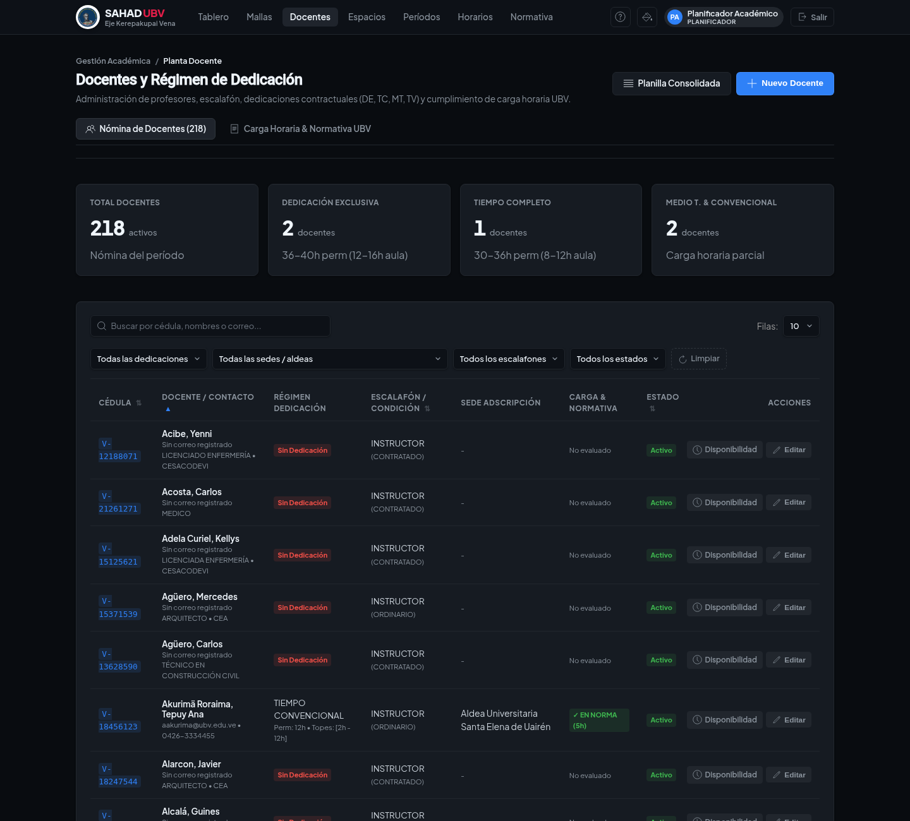
*Figura 24. Nómina vista por el Planificador: Disponibilidad y Editar, sin Suspender; badges de piso y días acordados.*

#### 5.3.2 Registrar un docente

**Nuevo Docente** abre el formulario con los datos personales (cédula, nombres, apellidos, correo y teléfono), la condición laboral y el escalafón, los datos académicos que exige la oferta (profesión, estudios de cuarto nivel, años de ingreso y concurso, centro de estudio) y el régimen contractual del período: dedicación, sede principal y observaciones (descargas, jefaturas, etc.).

En la sección **Adscripción Académica, Accesibilidad y Disponibilidad** complete:

- **PFG de Adscripción (Prioridad)**: programa al que el docente queda adscrito.
- **Piso máximo**: vacío si no hay restricción; 0 = planta baja, 1–3 = pisos superiores.
- **Motivo de la restricción de piso**, si aplica.
- **Tres días hábiles** (marque exactamente tres): el sistema no programará clases fuera de esos días (regla H-DIAS-DISPONIBILIDAD).

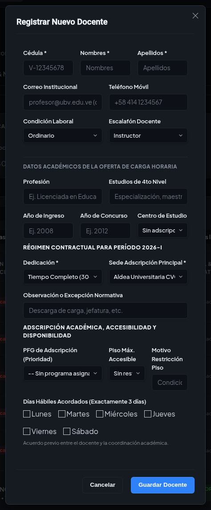
*Figura 25. Registro de un docente, incluida la sección de adscripción, piso y días.*

#### 5.3.3 Planilla consolidada de carga

**Planilla Consolidada** muestra, para cada docente, sus horas de docencia directa, proyecto o campo, asesorías e investigación, la permanencia total y su estado normativo: *En norma*, *Déficit* (por debajo del mínimo, regla H-05), *Sobrecarga* (por encima del máximo, regla H-04) o *Sin asignar*. Se puede filtrar por estado, dedicación y sede, e imprimir con **Imprimir Planilla**.

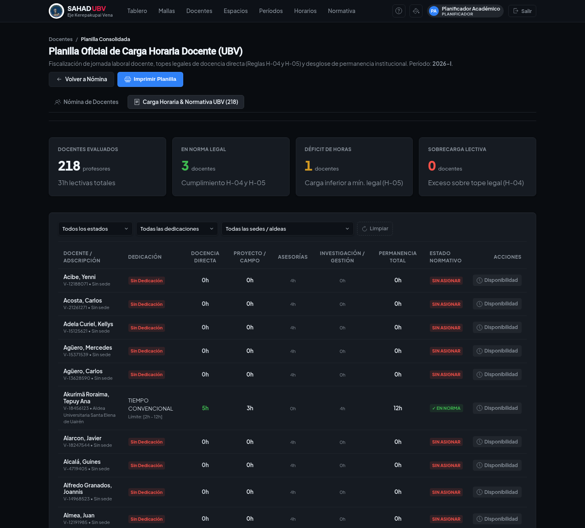
*Figura 26. Planilla oficial de carga horaria docente.*

#### 5.3.4 Disponibilidad horaria

La matriz de disponibilidad tiene una fila por bloque académico y una columna por día. Encima de la matriz aparecen pastillas con el **PFG de adscripción**, los **tres días acordados** y el **piso máximo** si el docente tiene restricción. Haga clic en una celda para cambiar su estado: **P1** (prioridad alta), **P2** (media), **P3** (baja) o **NO** (no disponible). Las **Acciones Rápidas** marcan todo como disponible, solo el turno de la mañana o de la tarde, o limpian todo. Pulse **Guardar Cambios** al terminar.

- El Docente la abre desde **Mi Disponibilidad** en el menú y solo puede editar la suya (figura 14). Si intenta abrir la de otro docente, el sistema responde *"Acceso denegado"*.
- El Administrador y el Planificador la abren desde **Docentes → Disponibilidad** para cualquier docente; el Coordinador, solo para los docentes con asignaciones de sus programas en el período (en los demás el botón no aparece). Está pensado para cuando el docente no puede hacerlo él mismo, por ejemplo por una emergencia o porque la entregó en papel.

Quien modifica la disponibilidad de **otro** docente debe escribir el **Motivo del cambio** (al menos 10 caracteres) en el recuadro que aparece debajo de la matriz; sin motivo, el navegador lo señala y no se guarda nada. Cada guardado que cambie algo queda en el **Historial de cambios** del período, al pie de la pantalla, con la fecha y hora (formato de 12 horas), el nombre, rol y correo de quien lo hizo, el resumen (por ejemplo, *"1 franja agregada, 1 cambio de prioridad"*), el detalle de franjas agregadas, quitadas o con otra prioridad, y el motivo. Los cambios del propio docente aparecen como *"Registrado por el propio docente"*. Guardar sin modificar nada no deja registro. El historial no se puede editar ni borrar desde la aplicación.

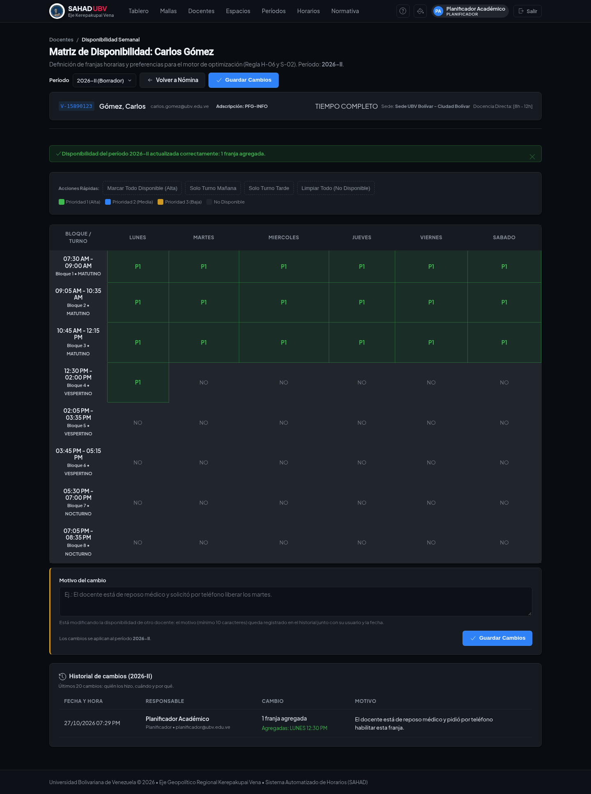
*Figura 27. Disponibilidad de un docente cargada por el Planificador: aviso de guardado, Motivo del cambio e Historial de cambios.*

La disponibilidad se registra **por período**. El selector **Período**, sobre la matriz, lista los períodos abiertos con su fase (por ejemplo, *2026-II (Planificación)* o *2026-I (Activo)*); los cerrados no aparecen porque ya no se programan. Al entrar, la pantalla abre el período en *Planificación* o *Borrador* más reciente, que es el que se va a programar; si no hay ninguno, el *Activo* más reciente. Al cambiar de período en el selector se carga la disponibilidad ya declarada para ese período, y **Guardar Cambios** guarda solo en el período elegido.

Esta información es vinculante: el optimizador solo programa las clases de un docente en sus franjas disponibles (regla H-06), y prefiere las de prioridad alta.

### 5.4 Espacios: sedes y aulas (`/espacios`)

**Aulas y Espacios Físicos** lista aulas, laboratorios y espacios de campo con su sede, tipo, aforo, piso (nivel numérico) y estado. **Nuevo Espacio** registra uno nuevo y cada fila tiene **Editar**; solo el Administrador ve **Desactivar**. El aforo es importante: el sistema impide asignar una sección a un aula con menos capacidad que su matrícula. El nivel de piso del aula se cruza con el piso máximo del docente (regla H-ACCESIBILIDAD-PISO).

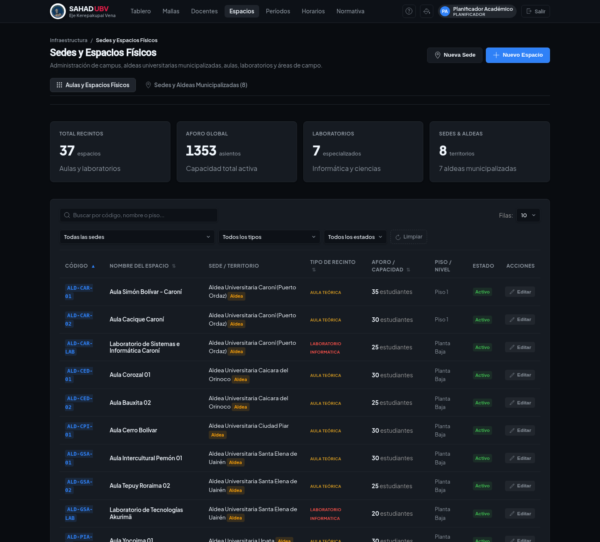
*Figura 28. Catálogo de aulas y espacios físicos.*

**Sedes y Aldeas Municipalizadas** lista las sedes con su eje territorial, carácter (sede o aldea), cantidad de espacios y dirección. **Nueva Sede** registra una sede. Las distancias entre sedes se usan para la regla de traslado H-09.

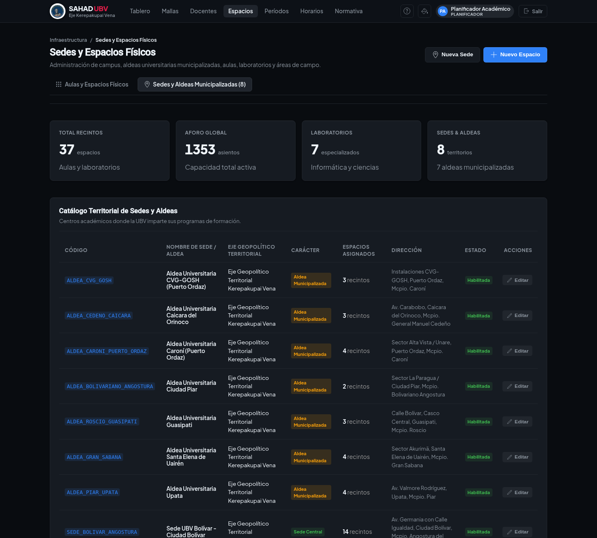
*Figura 29. Catálogo de sedes y aldeas municipalizadas.*

El Coordinador de PFG ve estas pantallas en modo consulta. El Planificador gestiona sedes y aulas, pero no puede desactivarlas.

### 5.5 Períodos y secciones (`/periodos`)

Este módulo es de la planificación (Administrador, Planificador y Coordinador). El Docente no lo ve en su menú y, si abre estas direcciones, el sistema lo lleva a su horario.

#### 5.5.1 Períodos académicos

La tabla muestra cada período con su calendario, fase y cobertura docente (asignaciones con docente sobre el total). Al final de cada fila están los accesos a **Secciones**, **Oferta**, **Horarios** y el menú **Fase**, con el que Administrador y Planificador cambian el estado del período (*Registro de Ofertas*, *Planificación*, *Oferta Aprobada*, *Activo*, *Cerrado*, etc.). Si la tabla no cabe en la pantalla, desplácela horizontalmente para ver todos los botones.

Antes de abrir la ventana de registro de ofertas, el sistema comprueba los **prerrequisitos**: al menos un docente activo, un aula o espacio activo y una unidad curricular activa. Si falta alguno, la transición se rechaza con el detalle de lo incompleto.

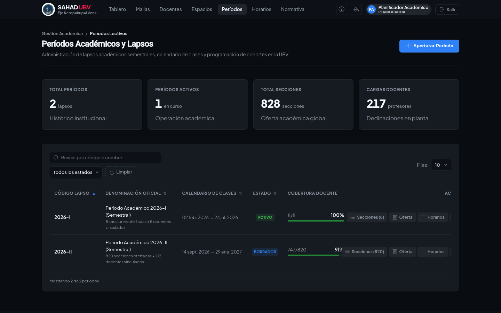
*Figura 30. Períodos académicos.*

**Aperturar Período** pide el código oficial (ej. `2026-II`), el nombre descriptivo, las fechas de inicio y culminación y la fase inicial.

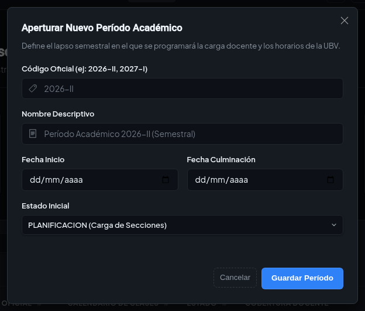
*Figura 31. Apertura de un período académico.*

#### 5.5.2 Secciones y asignaciones del período

**Secciones** muestra todas las asignaciones del período: cohorte, unidad curricular, programa y trayecto, turno, sede, docente responsable y cupos. Un distintivo indica si la **Ventana de Ofertas** está abierta, si la oferta está **Aprobada** (asignación de espacios en curso) o si el período ya está publicado. Los filtros permiten acotar por programa, turno, cohorte, sede y estado.

Mientras la ventana esté abierta (o si usted es Administrador o Planificador fuera de ella, salvo período cerrado), puede crear cohortes (**Nueva Sección (Cohorte)**) y asignaciones (**Nueva Asignación UC**). El Coordinador solo puede hacerlo en ventana abierta y sobre sus programas. En el alta de la asignación se eligen unidad, cohorte, turno y docente; el **aula física** se asigna después en la matriz o con el optimizador (solo Administrador y Planificador). Desde aquí también se accede a la oferta, a la matriz y, para esos dos roles, al optimizador.

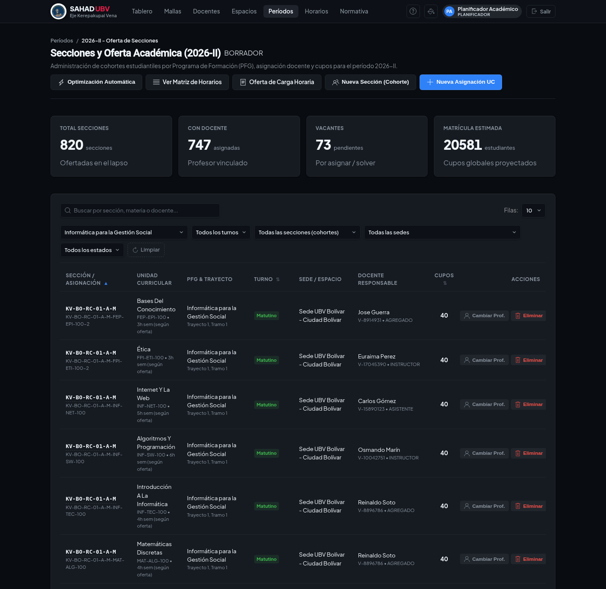
*Figura 32. Asignaciones del PFG Informática en el período 2026-II, con distintivo de ventana de ofertas.*

**Cambiar Prof.** abre la asignación de docente. La lista prioriza a quienes están **adscritos al programa** de la unidad curricular, luego muestra la carga actual, piso, días acordados y cómo quedaría la carga; **Solo con horas disponibles** oculta a los que superarían su tope. Si elige a un docente que excedería su máximo, el sistema lo advierte y rechaza la asignación (regla H-04). **Dejar vacante** deja la asignación como *Por asignar*.

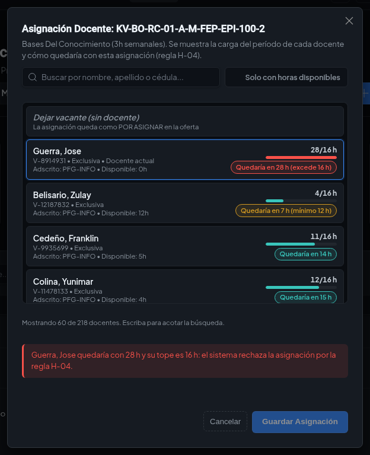
*Figura 33. Asignación de docente con control de carga, adscripción y horas disponibles.*

### 5.6 Oferta de carga horaria (`/periodos/:id/oferta`)

#### 5.6.1 Panel de la oferta

El panel resume las cohortes, asignaciones, vacantes, docentes con carga y matrícula del período, y lista las cohortes con su programa, trayecto y tramo, turno, sede, estatus y número de unidades curriculares y vacantes. **Ver UC** muestra las asignaciones de una cohorte y **Horario** abre su matriz.

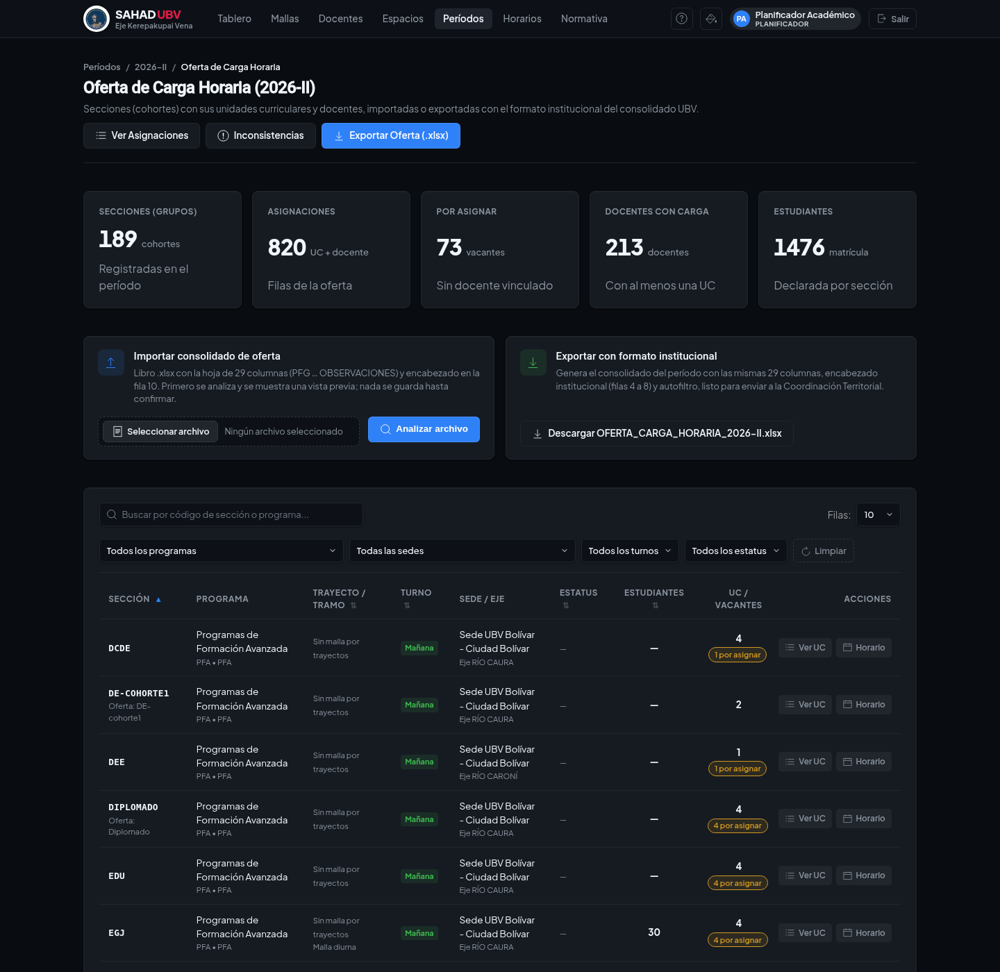
*Figura 34. Panel de la oferta de carga horaria (Planificador).*

El Coordinador ve solo sus programas; en lugar del importador aparece el aviso de que solo Administración y Planificación pueden importar la oferta.

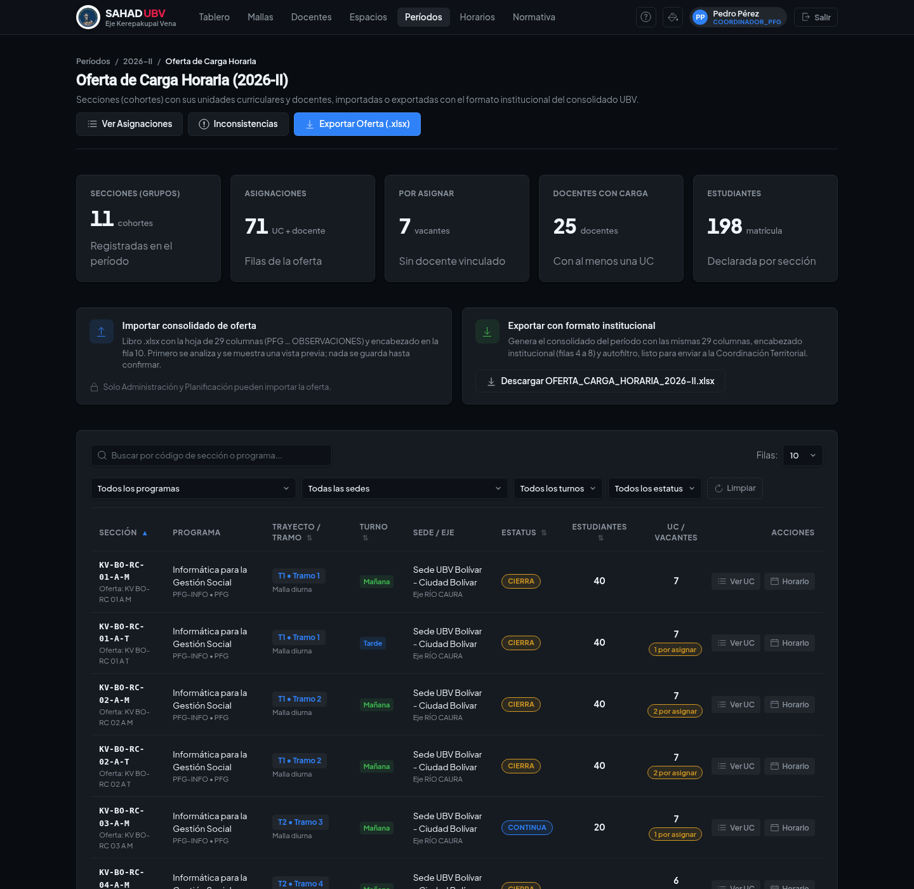
*Figura 35. La misma pantalla desde la cuenta del Coordinador.*

#### 5.6.2 Importar la oferta (Administrador y Planificador)

1. En **Importar consolidado de oferta**, pulse **Seleccionar archivo** y elija el libro `.xlsx` institucional (hoja de 29 columnas, de *PFG* a *OBSERVACIONES*, con el encabezado en la fila 10).
2. Pulse **Analizar archivo**. El sistema lee el libro sin guardar nada y muestra la **vista previa**: filas leídas y descartadas, cohortes, asignaciones y docentes nuevos o a actualizar, altas de catálogo, horarios indicados en las observaciones y docentes que quedarían con sobrecarga.
3. Revise la vista previa. **Descartar** cancela la importación; **Confirmar importación** guarda todo en una sola operación.

Antes de cada importación, el sistema guarda un respaldo automático de la base de datos.

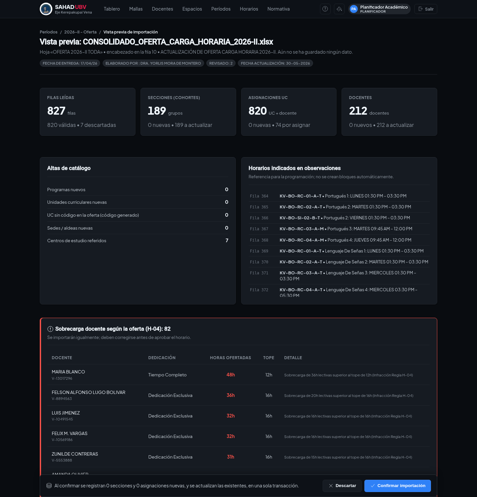
*Figura 36. Vista previa de la importación: aún no se ha guardado ningún dato.*

#### 5.6.3 Exportar la oferta

**Exportar Oferta (.xlsx)** o **Descargar OFERTA_CARGA_HORARIA_…xlsx** genera el consolidado del período con las mismas 29 columnas y el encabezado institucional, listo para enviar a la Coordinación Territorial.

#### 5.6.4 Inconsistencias

**Inconsistencias** agrupa lo que debe corregirse antes de programar:

- **Sobrecarga (H-04)** y **Déficit (H-05)**: docentes por encima o por debajo de los límites de su dedicación.
- **Sin dedicación**: docentes con carga pero sin régimen registrado.
- **Sin docente**: asignaciones vacantes.
- **Códigos provisionales**: unidades curriculares que llegaron sin código oficial; confírmelos aquí o desde la malla.
- **Dedicación contradictoria**: diferencias entre la dedicación del archivo importado y la registrada.

Pulse una tarjeta para ver su lista. Cada fila tiene accesos a las asignaciones y al horario del docente. **Exportar Reporte (.xlsx)** descarga todas las categorías.

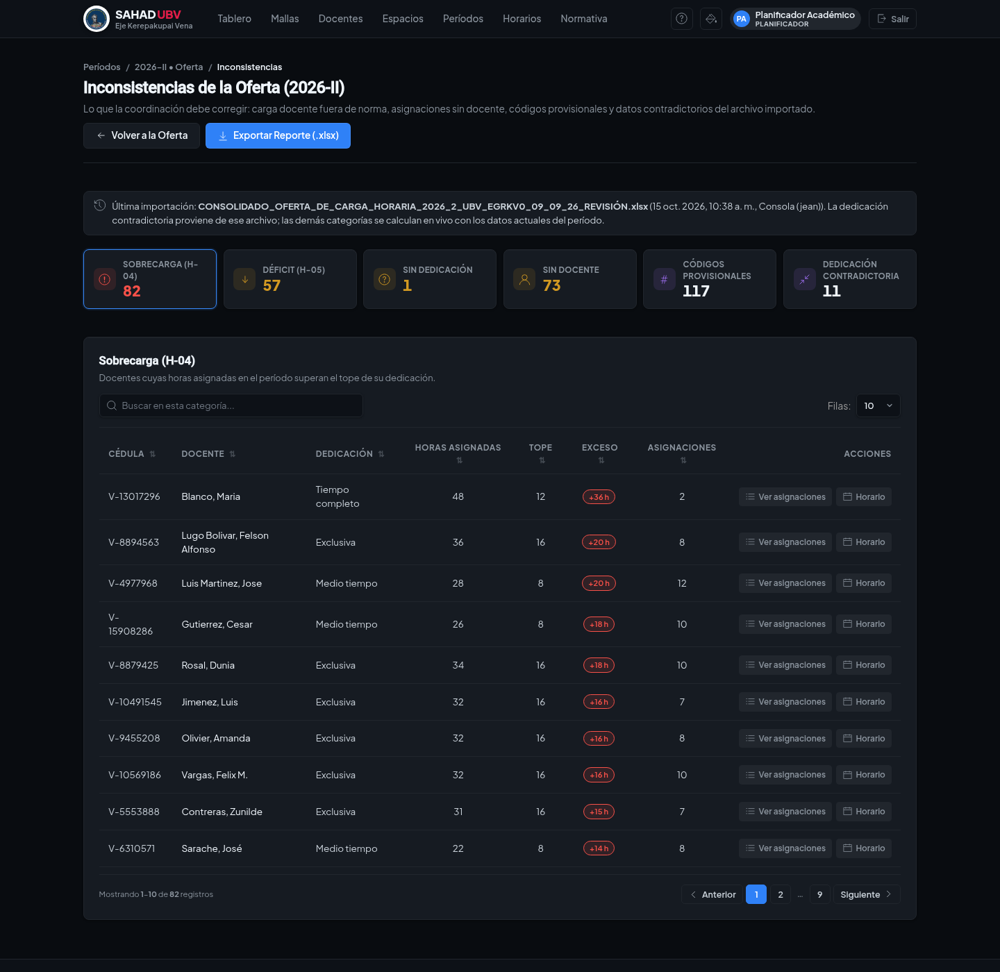
*Figura 37. Inconsistencias de la oferta, categoría Sobrecarga.*

### 5.7 Matriz de horarios (`/periodos/:id/horarios`)

La matriz es el centro de la programación. Muestra la semana (lunes a sábado) en filas de bloques académicos con su horario en formato de 12 horas (AM/PM) y su turno. A la derecha, la bandeja **Por Programar** lista las asignaciones que aún no tienen todos sus bloques (solo visible cuando se puede programar).

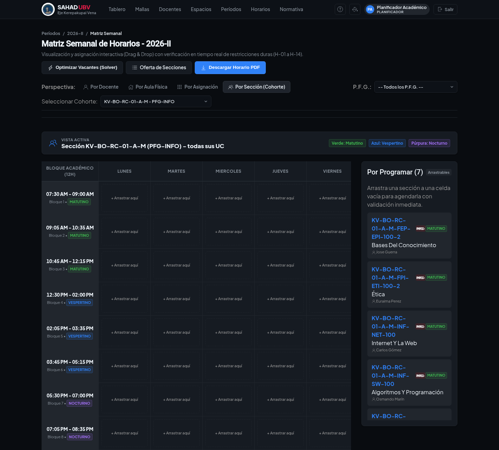
*Figura 38. Matriz de una cohorte antes de programar: las asignaciones esperan en la bandeja Por Programar.*

Solo el **Administrador** y el **Planificador** pueden arrastrar bloques y ejecutar el optimizador. El **Coordinador** y el **Docente** ven la matriz en modo solo lectura.

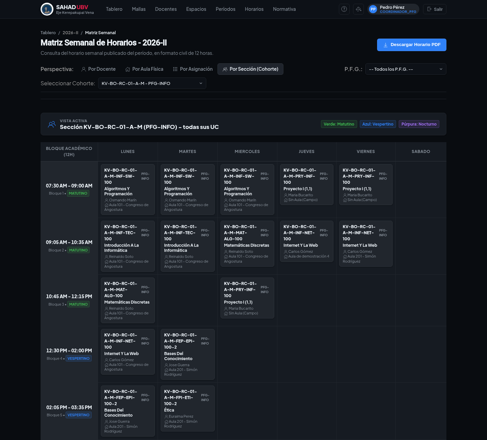
*Figura 39. Matriz del Coordinador en modo consulta: sin optimizador, sin bandeja editable y sin arrastrar bloques.*

#### 5.7.1 Perspectivas y filtro por programa

Bajo la cabecera se elige la perspectiva y la entidad a mostrar:

- **Por Docente**: la agenda semanal de un profesor.
- **Por Aula Física**: la ocupación de un aula o laboratorio.
- **Por Asignación**: los bloques de una sola asignación.
- **Por Sección (Cohorte)**: el horario completo de una cohorte con todas sus unidades curriculares.

El selector **P.F.G.** limita la matriz y la bandeja a un programa.

*Figura 40. Selectores de perspectiva, entidad y programa.*

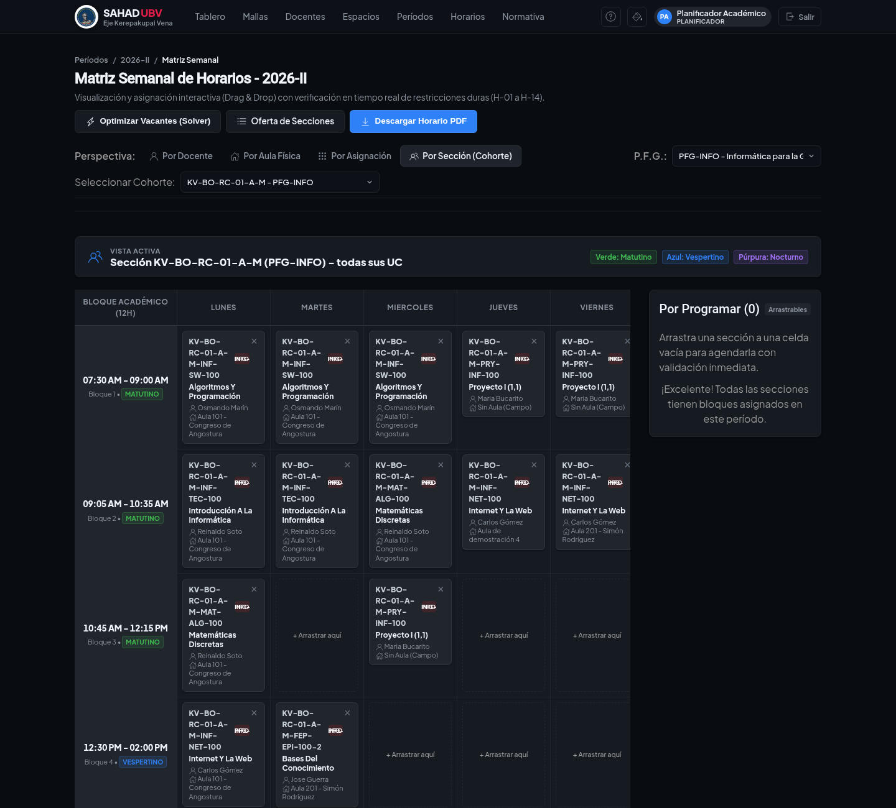
*Figura 41. Perspectiva Por Sección (Cohorte): horario completo de KV-BO-RC-01-A-M. Los bloques sin aula son de Proyecto Comunitario.*

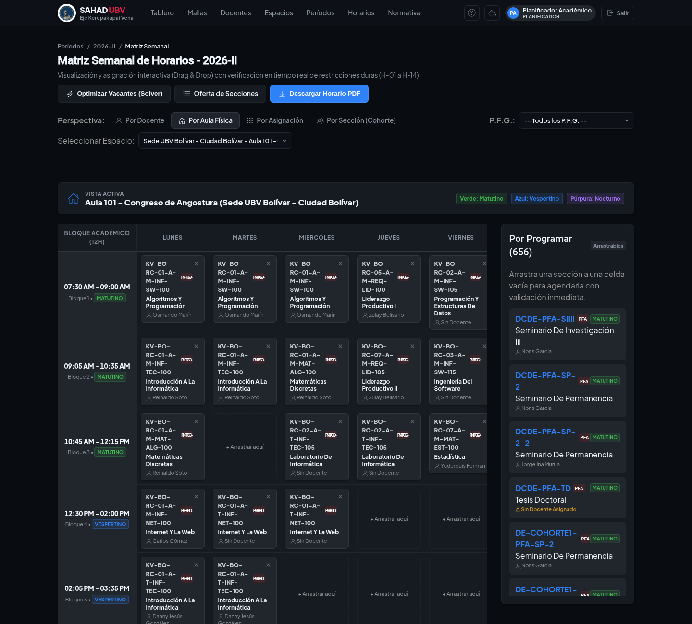
*Figura 42. Perspectiva Por Aula Física.*

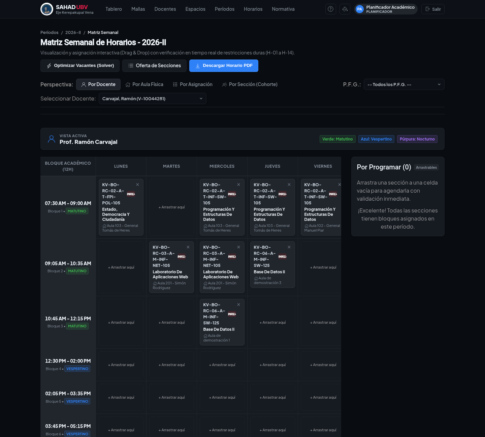
*Figura 43. Perspectiva Por Docente.*

Cada tarjeta muestra el código de la asignación, el programa, la unidad curricular, el docente y el aula. El color del turno está indicado en la leyenda: verde para matutino, azul para vespertino y púrpura para nocturno.

El Docente ve la matriz en modo de solo consulta, solo con su propio horario y sin estos selectores (sección 4.4).

#### 5.7.2 Asignar y mover bloques (arrastrar y soltar)

Disponible únicamente para Administrador y Planificador:

1. Arrastre una tarjeta de la bandeja **Por Programar** a una celda vacía, o arrastre un bloque ya colocado a otra celda para moverlo.
2. Al soltarla, el sistema valida al instante las restricciones duras (sección 6). Si el movimiento es válido, se abre **Confirmar Asignación en Matriz** con el mensaje *"Movimiento verificado y legalmente factible"*.
3. Elija el aula (en Proyecto Comunitario no se usa aula: el bloque queda como trabajo de campo), escriba la justificación para la auditoría y pulse **Guardar Asignación**. El servidor vuelve a validar antes de guardar.
4. Para quitar un bloque, pulse la **×** de su tarjeta.

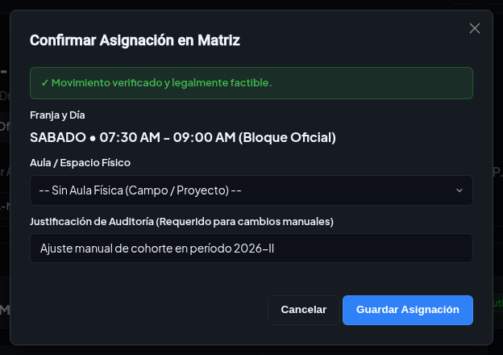
*Figura 44. Confirmación de un movimiento válido.*

Si el movimiento viola una restricción, aparece **Movimiento Bloqueado por Conflicto Normativo** con el motivo, y no se guarda nada.

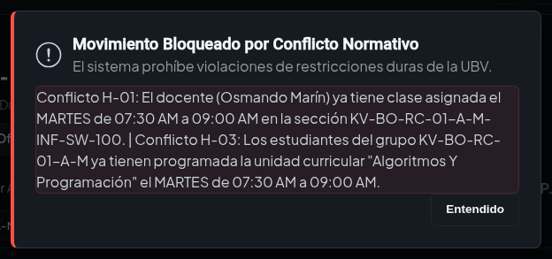
*Figura 45. Movimiento bloqueado: la cohorte ya tiene otra unidad curricular en ese bloque (H-03).*

#### 5.7.3 Optimización automática (solver)

**Optimizar Vacantes (Solver)** (solo Administrador y Planificador) calcula una propuesta de horario para las asignaciones pendientes:

1. Revise el diagnóstico. Muestra las asignaciones vacantes, los bloques que requieren, cuántos de sus docentes **declararon disponibilidad** en el período y la **Factibilidad Base**:
   - **OK**: todos los docentes declararon franjas suficientes y cada asignación tiene en su sede un aula con aforo suficiente.
   - **REVISAR**: debajo aparece la lista de lo que impedirá programar: docentes sin disponibilidad declarada (con sus secciones), docentes con menos franjas que bloques requeridos y secciones sin un aula de aforo suficiente en su sede. Corríjalo antes de optimizar o esas asignaciones quedarán sin programar.
2. Elija el **Motor de Optimización** (Google OR-Tools CP-SAT o Algoritmo Genético) y la **Estrategia** (más rápida o más profunda). **Aplicar a BD si es factible** guarda el resultado automáticamente si no hay conflictos.
3. Pulse **Iniciar Optimización Automática**.

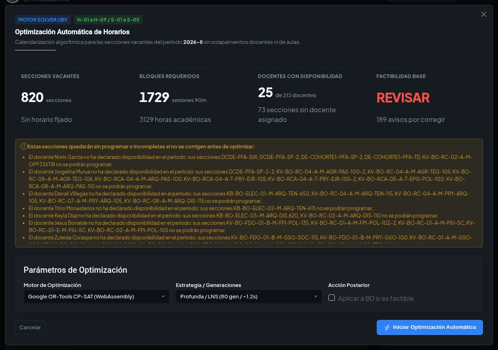
*Figura 46. Diagnóstico del Planificador sobre todo el período: la Factibilidad Base indica REVISAR y lista los docentes sin disponibilidad declarada.*

Si el resultado es **FACTIBLE (0 Conflictos Duros)**, revise la propuesta y pulse **Confirmar y Aplicar a Base de Datos**.

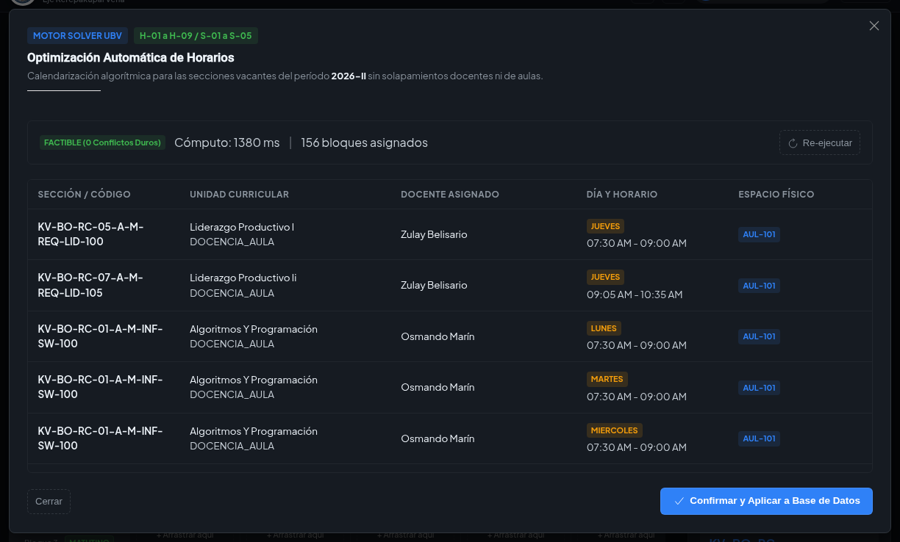
*Figura 47. Propuesta factible del Planificador filtrada por el programa PFG-INFO.*

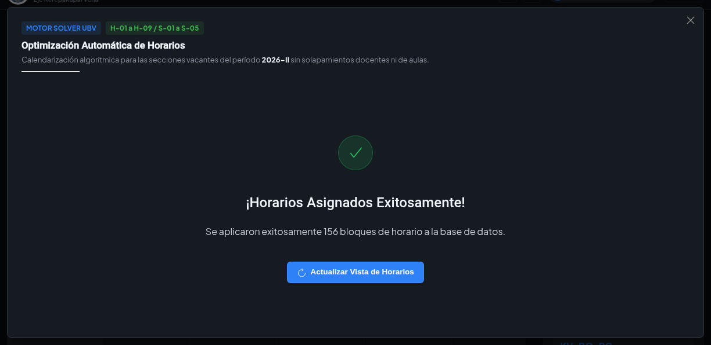
*Figura 48. Horarios aplicados; pulse Actualizar Vista de Horarios para verlos en la matriz.*

Reglas del optimizador que conviene conocer:

- Una asignación con docente solo se programa en las franjas que ese docente **declaró disponibles** en el período (H-06). Si no declaró ninguna, o declaró menos franjas que los bloques que requiere la materia, la asignación no se programa.
- Los horarios ya guardados se respetan como fijos.
- Se respetan la reserva institucional de los martes (H-13), los bloques fijos de Liderazgo (H-14), los tres días acordados y la accesibilidad de piso.
- Si queda alguna asignación sin programar o algún conflicto, el resultado es **INFACTIBLE**: se listan los conflictos (figura 10) y no se ofrece aplicar la propuesta. Cada conflicto identifica a los docentes por su nombre, las aulas por su código, las cohortes por el código del grupo y las sedes por su nombre, con la hora en formato de 12 horas. Corrija la causa (normalmente, disponibilidad no declarada o falta de aulas) y vuelva a ejecutar.

#### 5.7.4 Exportar el horario en PDF

**Descargar Horario PDF** genera el horario oficial de la perspectiva visible (docente, aula o cohorte) con el membrete institucional, el período, la fecha de emisión y los bloques en formato de 12 horas, listo para firmar y publicar. Cada bloque del PDF muestra el código de la asignación, la unidad curricular, el docente y el aula.

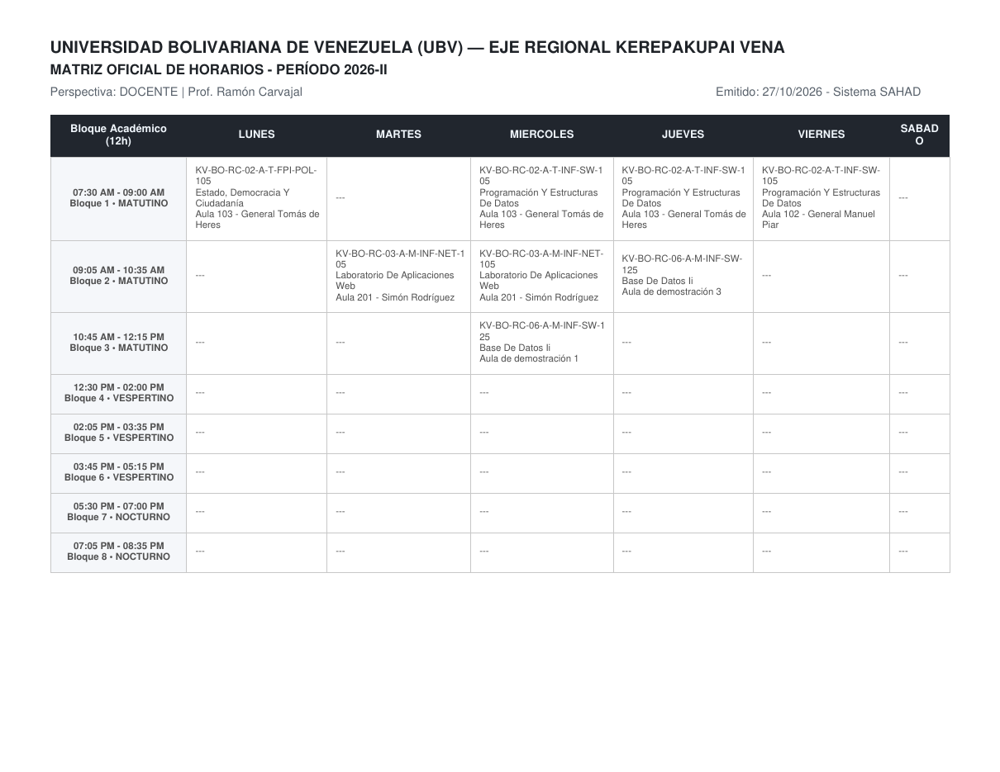
*Figura 49. Primera página del PDF del horario de un docente.*

### 5.8 Normativa y reportes (`/reportes`)

**Normativa** (en el menú, o la tarjeta *Normativa y Reportes* del tablero) reúne en una sola página las reglas que el sistema aplica y las planillas oficiales del período vigente:

- **Reportes y exportaciones**: botones para abrir o descargar cada planilla. Administrador, Planificador y Coordinador ven la planilla consolidada de carga docente, la oferta del período (.xlsx), el reporte de inconsistencias (.xlsx) y el acceso a la matriz para PDF; el Coordinador, solo de sus programas. El Docente ve **Mi horario**, **Mi disponibilidad** y la descarga de la **oferta (.xlsx)**; no ve inconsistencias ni la planilla consolidada.
- **Restricciones duras** (H-01 a H-14, más accesibilidad de piso y días acordados): reglas que siempre se cumplen; un horario que viole una de ellas no se guarda.
- **Restricciones blandas** (S-01 a S-08): preferencias que el optimizador procura cumplir, con su peso relativo.
- **Límites por dedicación**: horas semanales mínimas y máximas de docencia directa, permanencia, proyecto comunitario e investigación para DE, TC, MT y TV.
- **Bloques académicos oficiales**: los 8 bloques de 90 minutos con su horario en formato de 12 horas y su turno, incluida la reserva de los martes (H-13) y los bloques fijos de Liderazgo (H-14).

Si no hay ningún período abierto, la página muestra las reglas pero no las exportaciones del período.

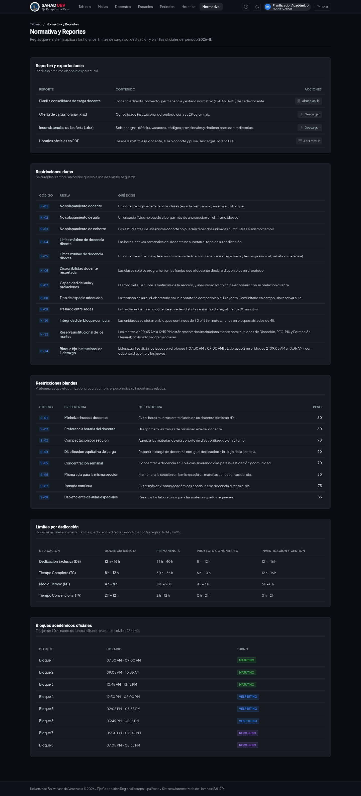
*Figura 50. Página de Normativa y Reportes con el catálogo hasta H-13 y H-14.*

---

## 6. Mensajes del sistema

Cuando el sistema rechaza un horario, el mensaje empieza con el código de la regla y nombra lo afectado: el docente por su nombre, el aula por su código, la cohorte por el código del grupo o de la sección, y la hora en formato de 12 horas (por ejemplo, *"Conflicto H-01: El docente Carlos Gómez tiene asignaciones solapadas el LUNES a las 02:05 PM (secciones INF-101-01, MAT-101-01)."*). Este es su significado y qué hacer en cada caso:

| Código | Qué significa | Qué hacer |
| :--- | :--- | :--- |
| **H-01** | El docente ya tiene otra clase en ese bloque. | Elija otro bloque o cambie el docente de la asignación. |
| **H-02** | El aula ya está ocupada por otra sección en ese bloque. | Elija otra aula u otro bloque. |
| **H-03** | La cohorte ya tiene otra unidad curricular en ese bloque. | Elija otro bloque; los estudiantes no pueden estar en dos clases a la vez. |
| **H-04** | La carga del docente superaría el máximo de su dedicación. | Asigne la unidad a otro docente o revise la dedicación registrada. |
| **H-05** | La carga del docente queda por debajo del mínimo de su dedicación. | Asígnele más unidades o registre la causal (descarga, jefatura, etc.) en las observaciones. |
| **H-06** | El docente no declaró disponibilidad en esa franja, o no declaró ninguna en el período. | Pida al docente que registre su disponibilidad, o elija una franja que haya marcado como disponible. |
| **H-07** | En la matriz: el bloque coincide con una unidad que es prelación de esta. En el optimizador: el aforo del aula es menor que la matrícula de la sección. | Elija otro bloque, o un aula con mayor capacidad. |
| **H-08** | El tipo de espacio no corresponde: una unidad de laboratorio en aula teórica, una teórica sin aula, o un Proyecto Comunitario con aula. | Asigne un espacio del tipo requerido; en Proyecto Comunitario no indique aula. |
| **H-09** | El docente no tiene 90 minutos para trasladarse entre dos sedes distintas el mismo día. | Separe las clases en sedes distintas o prográmelas en días diferentes. |
| **H-10** | Las unidades se dictan en bloques continuos de 90 o 135 minutos, nunca en franjas aisladas de 45. | Agrupe la carga en bloques oficiales consecutivos. |
| **H-13** | El martes de 10:45 AM a 12:15 PM está reservado para reuniones institucionales; no se programa clase. | Elija otro bloque o otro día. |
| **H-14** | Liderazgo I o II debe dictarse en su bloque fijo de los jueves, con docente disponible ese día. | Programe Liderazgo I a las 07:30 AM o Liderazgo II a las 09:05 AM los jueves, y verifique los 3 días del docente. |
| **H-ACCESIBILIDAD-PISO** | El aula está en un piso superior al máximo permitido para el docente. | Elija un aula en planta baja o en un piso permitido, o revise el piso máximo del docente. |
| **H-DIAS-DISPONIBILIDAD** | El día elegido no está entre los tres días hábiles acordados del docente. | Elija uno de los tres días registrados en su ficha, o actualice esos días con la coordinación. |
| **INTEGRIDAD** | El optimizador no encontró bloques suficientes para completar las horas semanales de una asignación. | Amplíe la disponibilidad del docente, libere aulas del turno o ajuste a mano. |

Otros mensajes frecuentes:

- **"Acceso denegado"** o **"No tiene privilegios suficientes"**: la acción no corresponde a su rol o a sus programas (sección 3).
- **"Credenciales inválidas"**: correo o contraseña incorrectos.
- **"Seleccione al menos un programa de formación para el coordinador"**: al guardar un coordinador sin programas vinculados.
- **"El período indicado no existe o está cerrado: no se guardaron cambios."**: al guardar disponibilidad en un período cerrado. Elija un período abierto en el selector.
- **"Indique el motivo del cambio (al menos 10 caracteres): no se guardaron cambios."**: al guardar la disponibilidad de otro docente sin explicar el motivo. Escríbalo en **Motivo del cambio** y vuelva a guardar.
- **"Sin cambios en la disponibilidad del período ...: no se registró nada."**: se pulsó **Guardar Cambios** sin modificar ninguna celda; no se agrega nada al historial.
- **"Solo puede consultar su propio horario."**: un docente intentó abrir el horario de un aula, una cohorte u otro docente; el sistema muestra el suyo.
- **"La gestión de períodos y secciones corresponde a la planificación; se muestra su horario."**: un docente abrió el listado de períodos o las asignaciones de un período; el sistema lo lleva a su horario.
- **"No hay períodos académicos abiertos."**: al abrir Horarios sin ningún período en Borrador, Planificación o Activo.
- **"La ventana de oferta académica está cerrada (...). No se pueden agregar secciones."** (y mensajes análogos al registrar cohortes, cambiar docente o eliminar): el Coordinador intentó modificar la oferta fuera de la ventana; espere a que se reabra o solicite el ajuste al Planificador.
- **"No hay docentes activos..."** / **"No hay aulas..."** / **"No hay unidades curriculares activas..."**: faltan prerrequisitos al abrir el registro de ofertas; complete el catálogo antes de cambiar la fase.
- **Factibilidad Base: REVISAR** (en el optimizador): hay docentes sin disponibilidad suficiente o secciones sin aula de aforo suficiente; la lista indica cuáles (5.7.3).

---

## 7. Soporte

- Pulse **?** en la barra superior para abrir la ayuda en línea en cualquier pantalla.
- La ayuda en línea también enlaza a este manual y al Manual Técnico.
- Para problemas de acceso (contraseña olvidada, cuenta desactivada o programas mal asignados), contacte al Administrador del sistema.
- Para dudas sobre la oferta, la carga docente o los horarios, contacte al Planificador académico o a la Coordinación de su programa.
