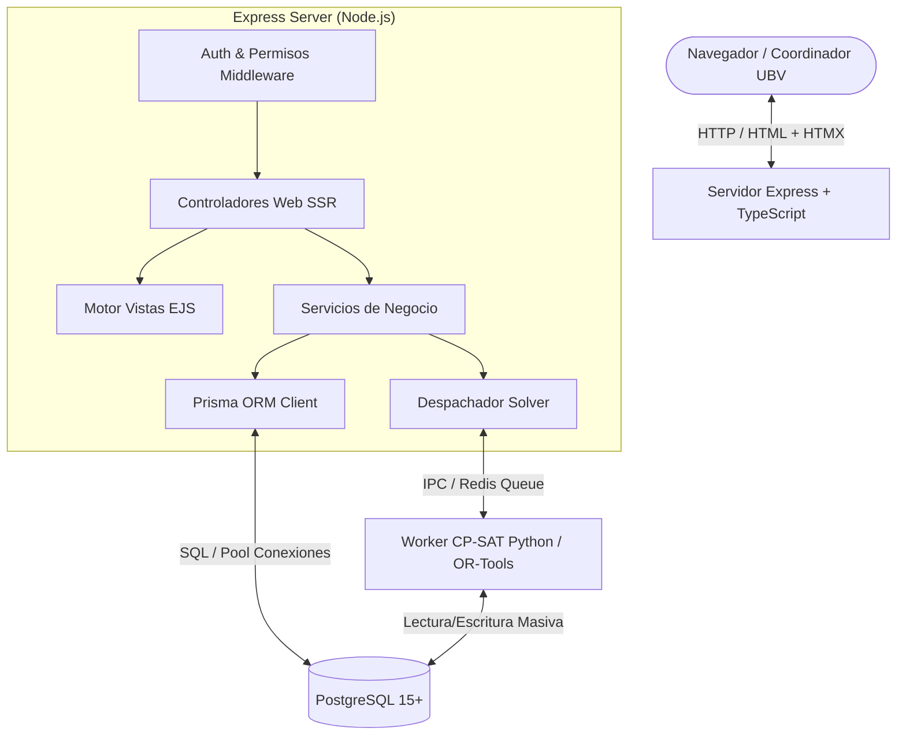

# Spec 0: Arquitectura Tecnológica y Stack de Ejecución
**Sistema de Carga Horaria y Asignación Automática de Horarios (SCHAAH - UBV)**

---

## 1. Definición del Stack Tecnológico

| Capa | Tecnología | Justificación |
| :--- | :--- | :--- |
| **Runtime & Gestor** | Node.js (v20+ LTS) + pnpm (v9+) | Instalaciones rápidas, deduplicación eficiente en disco y lockfile determinista (`pnpm-lock.yaml`). |
| **Lenguaje** | TypeScript (v5+) | Tipado estático estricto, contratos de dominio compartidos y compilación limpia. |
| **Framework Web** | Express.js (v4 / v5) | Enrutamiento ligero, modular por routers, middleware robusto. |
| **Renderizado Servidor (SSR)** | EJS + `express-ejs-layouts` | SSR con motor de layouts maestro automático (`layouts/main.ejs`); garantiza herencia visual en todas las vistas de controladores. |
| **ORM & Persistencia** | Prisma ORM | Modelado declarativo de esquemas, migraciones seguras y generación automática de tipos TypeScript. |
| **Base de Datos (Desarrollo)** | SQLite 3 (Modo WAL) | Motor embebido sin dependencias externas; concurrencia optimizada mediante `PRAGMA journal_mode = WAL;`. |
| **Base de Datos (Producción)** | PostgreSQL 15+ | Soporte relacional corporativo con extensiones `btree_gist` para exclusiones temporales. |
| **Motor Solver** | Google OR-Tools (CP-SAT) en Python Worker | Proceso worker dedicado o invocado vía subproceso CLI / Cola asíncrona (BullMQ + Redis) para resolver el problema NP-duro sin bloquear el event loop de Express. |
| **Diseño Web & UI** | Clean Enterprise SaaS (Linear/Vercel) + UIkit 3 | Estética sobria, moderna y de alta densidad. Cabecera fija de 54px en una sola fila, tarjetas Bento, tablas de datos con búsqueda en vivo, modales limpios y soporte dual de temas claro y oscuro con persistencia en `localStorage`. |

---

## 2. Diagrama de Arquitectura de la Aplicación



---

## 3. Estructura del Proyecto

```text
schaah/
├── package.json
├── tsconfig.json
├── prisma/
│   ├── schema.prisma            # Spec del ORM y modelos de base de datos
│   └── migrations/              # Migraciones versionadas
├── src/
│   ├── server.ts                # Inicialización de Express
│   ├── config/                  # Variables de entorno y configuración
│   ├── core/
│   │   ├── domain/              # Tipos TypeScript, Enums, Reglas H y S
│   │   └── errors/              # Manejo centralizado de excepciones
│   ├── modules/
│   │   ├── auth/                # Sesiones y control de acceso
│   │   ├── docentes/            # Gestión de profesores, dedicaciones y disponibilidad
│   │   ├── espacios/            # Sedes y aulas
│   │   ├── curricular/          # PFG y Unidades Curriculares
│   │   ├── periodos/            # Períodos lectivos y secciones
│   │   ├── horarios/            # Asignación, visualizador semanal y drag & drop
│   │   └── solver/              # Puente de ejecución con el solver CP-SAT
│   ├── views/                   # Plantillas SSR (EJS)
│   │   ├── layouts/             # Base layout, header, navegación
│   │   ├── partials/            # Componentes reutilizables (tablas, alertas, modales)
│   │   └── pages/               # Vistas específicas por módulo
│   └── public/                  # Assets estáticos (CSS, scripts ligeros para Drag & Drop)
├── worker/
│   ├── solver_cpsat.py          # Script matemático en Python con OR-Tools
│   └── requirements.txt         # ortools, psycopg2-binary
└── specs/                       # Documentación formal de desarrollo
```

---

## 4. Estándar de Gestión de Paquetes (pnpm)

- Gestor mandatorio: `pnpm`.
- Archivo de bloqueo: `pnpm-lock.yaml` (estricto en CI/CD).
- Comandos canónicos:
  - Instalación: `pnpm install`
  - Generación Prisma: `pnpm prisma:generate` (o `pnpm dlx prisma generate`)
  - Migraciones: `pnpm prisma:migrate`
  - Servidor de desarrollo: `pnpm dev`
  - Compilación de producción: `pnpm build`
  - Arranque de producción: `pnpm start`

