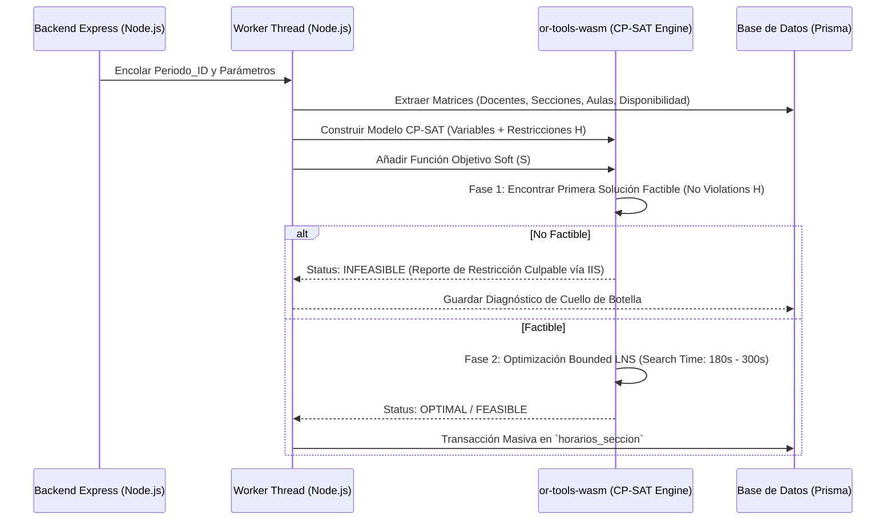

# Spec 3: Formulación Matemática del Motor Solver (CP-SAT)
**Sistema Automatizado para la Asignación de Horarios Académicos (SAHAD — UBV Eje Regional Kerepakupai Vena)**
**Tecnología Base: Google OR-Tools (Constraint Programming - SAT)**

---

## 1. Discretización del Tiempo y Conjuntos del Modelo

Para garantizar determinismo y resolver el problema UCBTP (University Course Timetabling) sin explosión combinatoria:

### 1.1 Discretización Temporal
- **Semana Lectiva**: $\mathcal{D} = \{1, 2, 3, 4, 5, 6\}$ (Lunes a Sábado).
- **Bloque Elemental ($\tau$)**: 45 minutos (1 hora académica).
- **Slots por Día**: Cada día se divide en $K = 18$ slots de 45 minutos entre 07:30 y 21:00.
- **Conjunto de Tiempos**: $\mathcal{T} = \{(d, k) \mid d \in \mathcal{D}, k \in \{1, \dots, K\}\}$. Cardinalidad total $|\mathcal{T}| = 108$ slots.

### 1.2 Conjuntos de Entidades
- $\mathcal{P}$: Conjunto de profesores.
- $\mathcal{S}$: Conjunto de secciones a programar.
  - $\mathcal{S}_p \subseteq \mathcal{S}$: Secciones asignadas al profesor $p$.
- $\mathcal{E}$: Conjunto de espacios físicos (aulas y laboratorios).
- $\mathcal{E}_{com}$: Espacio virtual para trabajo de campo/comunitario (sin conflicto de aula física).
- $\mathcal{L}_s$: Duración requerida en slots de 45 min para la sección $s$ por semana.
- $\mathcal{C}_s$: Matrícula estimada de estudiantes para la sección $s$.
- $\mathcal{A}_e$: Capacidad de aforo del espacio físico $e$.
- $\mathcal{M}_s$: Tipo de espacio requerido por la sección $s$ (Aula, Lab Informática, etc.).
- $\mathcal{T}_{disp}(p) \subseteq \mathcal{T}$: Slots donde el profesor $p$ declaró disponibilidad.

---

## 2. Variables de Decisión

### 2.1 Variables Principales
$$X_{s, e, t} \in \{0, 1\} \quad \forall s \in \mathcal{S}, e \in \mathcal{E}, t \in \mathcal{T}$$
Indica si la sección $s$ se imparte en el espacio $e$ comenzando en el slot $t$.

### 2.2 Variables Auxiliares
$$U_{s, t} = \sum_{e \in \mathcal{E}} X_{s, e, t} \in \{0, 1\} \quad \forall s \in \mathcal{S}, t \in \mathcal{T}$$
Indica si la sección $s$ está activa en el slot $t$.

$$V_{p, t} = \sum_{s \in \mathcal{S}_p} U_{s, t} \in \{0, 1\} \quad \forall p \in \mathcal{P}, t \in \mathcal{T}$$
Indica si el profesor $p$ está dictando clase en el slot $t$.

$$W_{p, d} \in \{0, 1\} \quad \forall p \in \mathcal{P}, d \in \mathcal{D}$$
Indica si el profesor $p$ tiene al menos una clase asignada en el día $d$.

---

## 3. Restricciones Duras (Hard Constraints)

### H-01 & H-02: Integridad de Asignación Semanal de la Sección
Cada sección $s$ debe cubrir exactamente sus horas semanales requeridas en bloques indivisibles:
$$\sum_{e \in \mathcal{E}} \sum_{t \in \mathcal{T}} X_{s, e, t} = \frac{\mathcal{L}_s}{\text{TamBloque}(s)} \quad \forall s \in \mathcal{S}$$

### H-02: Exclusión de Aula (No Solapamiento en Espacio Físico)
Para todo espacio físico real $e \in \mathcal{E} \setminus \{\mathcal{E}_{com}\}$ y para todo slot $t \in \mathcal{T}$:
$$\sum_{s \in \mathcal{S}} \sum_{\tau = 0}^{\text{TamBloque}(s) - 1} X_{s, e, t - \tau} \le 1$$

### H-01: Exclusión de Profesor (No Solapamiento Docente)
Un docente no puede tener dos clases simultáneas:
$$V_{p, t} = \sum_{s \in \mathcal{S}_p} \sum_{e \in \mathcal{E}} \sum_{\tau = 0}^{\text{TamBloque}(s) - 1} X_{s, e, t - \tau} \le 1 \quad \forall p \in \mathcal{P}, \forall t \in \mathcal{T}$$

### H-03: Exclusión de Cohorte Estudiantil
Sea $\mathcal{G}$ el conjunto de cohortes del período y $\mathcal{S}_g \subseteq \mathcal{S}$ las asignaciones (unidad curricular + docente) de la cohorte $g$. Una asignación sin grupo forma su propia cohorte unitaria (`claveCohorte`: `G:<grupoId>` o `S:<seccionId>`). Los estudiantes de una cohorte no pueden tener dos materias solapadas:
$$\sum_{s \in \mathcal{S}_g} \sum_{e \in \mathcal{E}} \sum_{\tau = 0}^{\text{TamBloque}(s) - 1} X_{s, e, t - \tau} \le 1 \quad \forall g \in \mathcal{G}, \forall t \in \mathcal{T}$$

La carga de cada asignación $\mathcal{L}_s$ usa las horas semanales de la oferta del período cuando existen y, en su defecto, $H_T + H_P$ de la unidad curricular.

### H-04 & H-05: Límites Legales de Carga Docente Directa
Sea $H_{doc}(p)$ la carga docente asignada al profesor $p$ en horas académicas:
$$H_{doc}(p) = \sum_{s \in \mathcal{S}_p} \mathcal{L}_s$$
$$\text{MinDocencia}(p) \le H_{doc}(p) \le \text{MaxDocencia}(p) \quad \forall p \in \mathcal{P}$$

### H-06: Respeto Estricto de Disponibilidad Docente
Si el slot $t \notin \mathcal{T}_{disp}(p)$:
$$V_{p, t} = 0 \quad \forall p \in \mathcal{P}, \forall t \notin \mathcal{T}_{disp}(p)$$

Si $\mathcal{T}_{disp}(p) = \varnothing$ (el docente no declaró disponibilidad en el período), sus asignaciones no tienen variables candidatas y la igualdad de integridad no puede cumplirse: el modelo es infactible para esas asignaciones.

### Verificación de integridad en el evaluador
Ambos motores pasan su propuesta por `evaluarSolucion`, que comprueba la igualdad de integridad (cada asignación pendiente recibe $\mathcal{L}_s / \text{TamBloque}(s)$ bloques). Si falta alguno registra una violación dura y el resultado es `INFEASIBLE`, de modo que un motor no puede omitir asignaciones y reportar `OPTIMAL`:
- `H-06` si el docente no declaró disponibilidad o declaró menos franjas que los bloques requeridos (el mensaje nombra la sección y el docente).
- `INTEGRIDAD` si faltan bloques por otra causa (aulas, cohorte u ocupación existente).

Con resultado `INFEASIBLE` la interfaz lista las violaciones y no ofrece aplicar la propuesta.

### H-07 & H-08: Compatibilidad de Aforo y Tipo de Aula
$$X_{s, e, t} = 0 \quad \text{si } \mathcal{A}_e < \mathcal{C}_s \lor \text{Tipo}(e) \neq \mathcal{M}_s$$

Para las asignaciones de proyecto comunitario ($s \in \mathcal{S}_{PC}$) el único candidato de espacio es "sin aula" ($e = \varnothing$): no reservan espacio físico, pero sí ocupan el bloque del docente (H-01, H-06, H-09) y de la cohorte (H-03). Se guardan con `tipo_bloque = PROYECTO_COMUNITARIO`:
$$X_{s, e, t} = 0 \quad \forall s \in \mathcal{S}_{PC}, \forall e \neq \varnothing$$
El evaluador (`evaluator.ts`) trata como violación dura H-08 un bloque de proyecto con aula y uno regular sin aula.

### Alcance por programa (Spec 06)
Cuando ejecuta un coordinador, $\mathcal{S}$ contiene solo las asignaciones pendientes de sus programas. Los bloques ya guardados de cualquier programa entran como ocupación fija de docentes, aulas y cohortes (también en la semilla voraz del motor genético), y `aplicarPropuesta` rechaza completa una propuesta con asignaciones fuera del alcance o de otro período.

### H-09: Anti-Teletransportación Territorial
Sean $Sede(e_1) \neq Sede(e_2)$ y tiempo de traslado $\Delta k_{traslado} \ge 2$ slots (90 min). Si el profesor $p$ dicta en $e_1$ en $(d, k_1)$, no puede dictar en $e_2$ en $(d, k_2)$ si:
$$|k_2 - k_1| < \text{TamBloque}(s_1) + \Delta k_{traslado}$$

---

## 4. Función Objetivo y Restricciones Blandas (Soft Constraints)

Minimizar la función de penalización multiobjetivo escalarizada:

$$\min \mathcal{Z} = w_1 \cdot \text{PenalidadHuecos} + w_2 \cdot \text{PenalidadPreferencia} + w_3 \cdot \text{DiasExcesivos} + w_4 \cdot \text{FragmentacionSeccion}$$

### 4.1 Penalización de Huecos Docentes (S-01)
Penaliza slots vacíos entre la primera y la última clase del día para el profesor $p$:
$$\text{Span}_{p, d} = (\text{SlotFin}_{p, d} - \text{SlotInicio}_{p, d} + 1) - \sum_{k=1}^K V_{p, (d, k)}$$
$$\text{PenalidadHuecos} = \sum_{p \in \mathcal{P}} \sum_{d \in \mathcal{D}} \text{Span}_{p, d}$$
*Peso sugerido: $w_1 = 80$.*

### 4.2 Violación de Preferencias Horarias (S-02)
Sea $\text{PrefPenalty}(p, t) \in [0, 5]$ según la prioridad declarada:
$$\text{PenalidadPreferencia} = \sum_{p \in \mathcal{P}} \sum_{t \in \mathcal{T}} V_{p, t} \cdot \text{PrefPenalty}(p, t)$$
*Peso sugerido: $w_2 = 60$.*

### 4.3 Días Trabajados por Docente (S-05)
Compactar la carga docente en un máximo de 3 o 4 días:
$$\text{DiasExcesivos} = \sum_{p \in \mathcal{P}} \max\left(0, \sum_{d \in \mathcal{D}} W_{p, d} - 4\right)$$
*Peso sugerido: $w_3 = 70$.*

---

## 5. Estrategia de Ejecución en Google OR-Tools

### Parámetros del Solver en Producción
- `max_time_in_seconds`: 300.0 (5 minutos tope).
- `num_search_workers`: 8 hilos CPU concurrentes.
- `log_search_progress`: True (retransmitido vía WebSockets / SSE para barra de progreso en UI).
