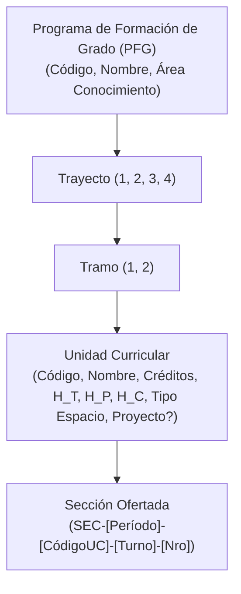

# Spec 9: Módulo Web de Mallas Curriculares y Unidades Curriculares
**Sistema de Carga Horaria y Asignación Automática de Horarios (SCHAAH - UBV)**

---

## 1. Fundamentación Curricular UBV

El Documento Rector de la Universidad Bolivariana de Venezuela (2003) y los diseños curriculares de los Programas de Formación de Grado (PFG) aprobados por el Consejo Nacional de Universidades (CNU) estructuran la formación universitaria bajo el régimen de **Trayectos Anuales** y **Tramos Semestrales**, combinando:
1. **Unidades Curriculares de Formación Básica y Especializada**: Con horas de teoría ($H_T$) y prácticas/laboratorios ($H_P$) que demandan aulas físicas o laboratorios especializados.
2. **Unidad Integradora de Proyecto Comunitario (P1 a P4)**: Eje transversal con horas de campo comunitario ($H_C$) que consumen dedicación y permanencia docente pero se ejecutan en comunidades sin requerimiento de aula universitaria física tradicional.

Para erradicar la apertura errática de asignaturas, la asignación de materias cruzadas no pertenecientes a la especialidad y el descuadre de bloques horarios frente a los créditos oficiales, SCHAAH implementa un **Módulo Web Administrativo de Mallas Curriculares y Unidades Curriculares**.

---

## 2. Jerarquía de Datos y Reglas de Integridad

### 2.1 Reglas de Dominio Curricular
- **`RC-01` Unicidad Curricular**: El código de cada Unidad Curricular es único dentro de su respectivo PFG (`@@unique([pfgId, codigo])`).
- **`RC-02` Pertenencia Estricta de Secciones**: Toda sección creada en un período lectivo debe derivarse obligatoriamente de una Unidad Curricular perteneciente al PFG seleccionado para la sección. Queda prohibida la asignación cruzada de materias entre mallas incompatibles.
- **`RC-03` Cómputo de Bloques de Horario**: La cantidad de horas lectivas a planificar semanalmente en el horario para una sección corresponde exactamente a la suma de $H_T + H_P$. 
  - Las horas de campo comunitario ($H_C$) se consolidan en la planilla docente pero no saturan el aforo de aulas en la matriz semanal.
- **`RC-04` Tipología Obligatoria de Espacio**: Cada Unidad Curricular define su requerimiento infraestructural (`AULA_TEORICA`, `LABORATORIO_INFORMATICA`, `LABORATORIO_CIENCIAS`, `AUDITORIO`, `CANCHA`, `TERRENO_COMUNITARIO`). El solver CP-SAT y el validador manual imponen esta restricción como regla dura `H-03`.
- **`RC-05` Tratamiento de Proyecto**: Las materias marcadas como `esProyectoComunitario = true` admiten asignación horaria con `espacioFisicoId = null` y bloque tipo `CAMPO_COMUNIDAD`.

---

## 3. Mapa de Rutas y Endpoints

| Método | Ruta | Controlador | Vista / Retorno | Permiso RBAC | Descripción |
| :--- | :--- | :--- | :--- | :--- | :--- |
| `GET` | `/curriculo` | `CurriculoController.index` | `pages/curriculo/index.ejs` | `ADMIN`, `DIR_ACAD`, `COORD_PFG` | Panel central de mallas curriculares. Selector de PFG y vista agrupada por Trayecto y Tramo. |
| `POST` | `/curriculo/pfg` | `CurriculoController.crearPfg` | Redirect `/curriculo?pfg=...` | `ADMIN`, `DIR_ACAD` | Registro de nuevo Programa de Formación de Grado. |
| `POST` | `/curriculo/pfg/:id/editar` | `CurriculoController.editarPfg` | Redirect `/curriculo?pfg=...` | `ADMIN`, `DIR_ACAD` | Modificación de código, nombre o área de conocimiento de un PFG. |
| `POST` | `/curriculo/pfg/:id/toggle` | `CurriculoController.togglePfg` | Redirect `/curriculo` | `ADMIN`, `DIR_ACAD` | Activación o suspensión de un PFG. |
| `POST` | `/curriculo/unidades` | `CurriculoController.crearUnidad` | Redirect `/curriculo?pfg=...` | `ADMIN`, `DIR_ACAD`, `COORD_PFG` | Registro de asignatura dentro de la malla curricular (con desglose de horas y tipo de espacio). |
| `POST` | `/curriculo/unidades/:id/editar` | `CurriculoController.editarUnidad` | Redirect `/curriculo?pfg=...` | `ADMIN`, `DIR_ACAD`, `COORD_PFG` | Actualización de parámetros académicos, horas o tipología de la asignatura. |
| `POST` | `/curriculo/unidades/:id/toggle` | `CurriculoController.toggleUnidad` | Redirect `/curriculo?pfg=...` | `ADMIN`, `DIR_ACAD`, `COORD_PFG` | Inhabilitación o habilitación de la materia para oferta en períodos activos. |
| `GET` | `/curriculo/api/pfg/:id/unidades` | `CurriculoController.apiUnidades` | JSON / HTMX Fragment | Todos autenticados | Catálogo de materias activas del PFG para poblar selects reactivos al aperturar secciones. |

---

## 4. Diseño de la Interfaz de Usuario (UI/UX)

Siguiendo las reglas de diseño institucional UBV ([`AGENTS.md`](../AGENTS.md)):

1. **Toolbar Superior Estandarizada en 2 Filas**:
   - **Fila 1**: Selector de PFG activo, buscador de asignaturas en tiempo real (`onkeyup`) y selector de filas por página.
   - **Fila 2**: Filtros desplegables por Trayecto (1 a 4), Tramo (1 a 2) y Tipo de Espacio, botón "Limpiar Filtros" y botón de acción principal ("+ Nueva Unidad Curricular").
2. **Organización Visual Bento**:
   - Tarjetas Bento colapsables o pestañas segmentadas por **Trayecto I, II, III y IV**.
   - Subdivisión limpia entre **Tramo 1** y **Tramo 2**.
3. **Columnas de la Tabla de Asignaturas (`clean-table`)**:
   - **Código & Nombre**: Badge con código oficial (ej. `INFO-101`) y título completo.
   - **Ubicación en Malla**: Badge semántico con `Trayecto T - Tramo S` y Unidades de Crédito (UC).
   - **Desglose Horario**: Chips visuales con $H_T$ (Teoría), $H_P$ (Práctica) y $H_C$ (Campo), más total computable.
   - **Tipo de Espacio**: Icono semántico y etiqueta (Aula Teórica, Laboratorio de Computación, etc.).
   - **Indicador Proyecto**: Badge dorado `Proyecto Comunitario` si aplica.
   - **Estado & Acciones**: Badge de estado y dropdown Bento (`.clean-dropdown`) con acciones de editar y activar/desactivar.
4. **Formulario Modal de Registro/Edición**:
   - Validación reactiva de suma de horas ($H_T + H_P + H_C > 0$).
   - Switch visual estilizado para Proyecto Comunitario con auto-ajuste de tipo de espacio requerido.
   - Alerta informativa con el cálculo estimado de bloques semanales de 90/135 minutos que generará en el solver.

---

## 5. Integración con el Módulo de Secciones y el Solver

1. **Apertura Asistida de Secciones (`/periodos/:id/secciones`)**:
   - El modal de creación de sección presenta primero la selección de PFG.
   - Al seleccionar el PFG, se filtran dinámicamente las Unidades Curriculares pertenecientes exclusivamente a esa malla.
   - Al seleccionar la Unidad Curricular, el sistema precalcula y muestra:
     - Horas teóricas y prácticas requeridas.
     - Bloques semanales requeridos para el horario.
     - Tipo de aula obligatoria que solicitará al solver.
2. **Garantía para el Solver CP-SAT / Genético**:
   - El solver lee directamente las horas semanales y tipología de espacio desde la Unidad Curricular vinculada a la sección, garantizando que el cronograma generado cumpla fielmente la normativa del PFG.
