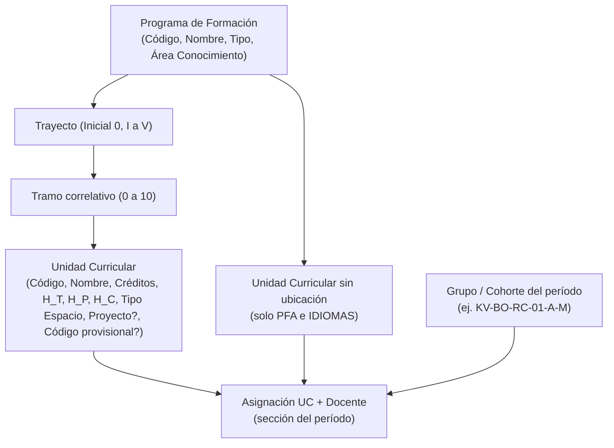

# Spec 9: Módulo Web de Mallas Curriculares y Unidades Curriculares
**Sistema Automatizado para la Asignación de Horarios Académicos (SAHAD — UBV Eje Regional Kerepakupai Vena)**

---

## 1. Fundamentación Curricular UBV

El Documento Rector de la Universidad Bolivariana de Venezuela (2003) y los diseños curriculares de los Programas de Formación de Grado (PFG) aprobados por el Consejo Nacional de Universidades (CNU) estructuran la formación universitaria bajo el régimen de **Trayectos Anuales** y **Tramos Semestrales**, combinando:
1. **Unidades Curriculares de Formación Básica y Especializada**: Con horas de teoría ($H_T$) y prácticas/laboratorios ($H_P$) que demandan aulas físicas o laboratorios especializados.
2. **Unidad Integradora de Proyecto Comunitario (P1 a P4)**: Eje transversal con horas de campo comunitario ($H_C$) que consumen dedicación y permanencia docente pero se ejecutan en comunidades sin requerimiento de aula universitaria física tradicional.

Para erradicar la apertura errática de asignaturas, la asignación de materias cruzadas no pertenecientes a la especialidad y el descuadre de bloques horarios frente a los créditos oficiales, SAHAD implementa un **Módulo Web Administrativo de Mallas Curriculares y Unidades Curriculares**.

---

## 2. Jerarquía de Datos y Reglas de Integridad

### 2.0 Tipos de Programa
| Tipo | Descripción | Ubicación Trayecto/Tramo |
| :--- | :--- | :--- |
| `PFG` | Programa de Formación de Grado | Obligatoria (RC-06) |
| `PNF` | Programa Nacional de Formación | Obligatoria (RC-06) |
| `PIU` | Programa de Iniciación Universitaria | Obligatoria (Trayecto Inicial 0) |
| `PFA` | Programa de Formación Avanzada (posgrado por cohortes) | Opcional: ambos vacíos se guardan como `NULL`; si se indica uno, se exigen ambos y RC-06 |
| `IDIOMAS` | Cursos de idiomas | Opcional, igual que PFA |

La regla vive en `programaRequiereTrayecto()` y `resolverUbicacionMalla()` (`src/core/domain/rules/curriculoRules.ts`). El controlador usa siempre el tipo del PFG almacenado de la unidad, nunca el `pfgId` enviado por el formulario.

### 2.1 Reglas de Dominio Curricular
- **`RC-01` Unicidad Curricular**: El código de cada Unidad Curricular es único dentro de su respectivo PFG (`@@unique([pfgId, codigo])`).
- **`RC-02` Pertenencia Estricta de Secciones**: Toda sección creada en un período lectivo debe derivarse obligatoriamente de una Unidad Curricular perteneciente al PFG seleccionado para la sección. Queda prohibida la asignación cruzada de materias entre mallas incompatibles.
- **`RC-03` Cómputo de Bloques de Horario**: La cantidad de horas lectivas a planificar semanalmente en el horario para una sección corresponde exactamente a la suma de $H_T + H_P$. 
  - Las horas de campo comunitario ($H_C$) se consolidan en la planilla docente pero no saturan el aforo de aulas en la matriz semanal.
- **`RC-04` Tipología Obligatoria de Espacio**: Cada Unidad Curricular define su requerimiento infraestructural (`AULA_TEORICA`, `LABORATORIO_INFORMATICA`, `LABORATORIO_CIENCIAS`, `AUDITORIO`, `CANCHA`, `TERRENO_COMUNITARIO`). El solver CP-SAT y el validador manual imponen esta restricción como regla dura `H-03`.
- **`RC-05` Tratamiento de Proyecto**: Las materias marcadas como `esProyectoComunitario = true` admiten asignación horaria con `espacioFisicoId = null` y bloque tipo `CAMPO_COMUNIDAD`.
- **`RC-06` Correspondencia Estricta Trayecto-Tramo**: Todo Trayecto anual $T$ solo admite los dos Tramos semestrales correlativos correspondientes según la fórmula oficial UBV:
  $$\text{Tramos válidos para } T = \{2T - 1, \; 2T\} \quad (T \in \{1, 2, 3, 4, 5\})$$
  - **Trayecto Inicial (0)**: Únicamente Tramo 0 o Tramo 1.
  - **Trayecto I**: Únicamente Tramo 1 y Tramo 2.
  - **Trayecto II**: Únicamente Tramo 3 y Tramo 4.
  - **Trayecto III**: Únicamente Tramo 5 y Tramo 6.
  - **Trayecto IV**: Únicamente Tramo 7 y Tramo 8.
  - **Trayecto V**: Únicamente Tramo 9 y Tramo 10 (PFG de cinco años, ej. Psicología, Estudios Políticos).
  Queda prohibido registrar o actualizar una Unidad Curricular con un Tramo que no corresponda estrictamente a su Trayecto (y viceversa). Toda petición fuera de esta correspondencia debe ser rechazada con error de validación. Los valores deben ser enteros; texto o decimales se rechazan.
  - **Excepción por tipo de programa**: PFA e IDIOMAS admiten unidades sin Trayecto ni Tramo (ver §2.0).
  - **Datos incompletos de la oferta**: la importación del consolidado (Spec 10) puede dejar unidades de PFG sin trayecto o sin tramo. Al editarlas, el modal muestra un aviso y precarga una ubicación válida (el trayecto deducido del tramo, o Trayecto I) para que el usuario la confirme; no se permite guardarlas incompletas.
- **`RC-07` Prelaciones Curriculares**: Una unidad puede declarar como prelación (requisito) a otras unidades del **mismo PFG** ubicadas en un Trayecto/Tramo **estrictamente anterior**. Se prohíbe la autoprelación y las prelaciones con unidades sin ubicación en malla.
  - El servidor filtra las prelaciones enviadas con `filtrarPrelacionesValidas()`; las rechazadas se descartan y se informan en el mensaje de confirmación.
  - **Conservación**: si la petición no incluye el marcador `prelacionesEnviadas=1` (formularios sin selector), las prelaciones existentes se conservan y se revalidan contra la nueva ubicación; nunca se borran por omisión.
  - **RC-07 inverso**: se rechaza mover una unidad a un Trayecto/Tramo que deje inválidas las prelaciones de otras unidades que dependen de ella (`dependientesInvalidadas()`); el error lista los códigos afectados.
  - La actualización de la unidad y de sus prelaciones se ejecuta en una sola transacción.
  - Las prelaciones alimentan la regla horaria `H-07` (no solapar una unidad con sus prerrequisitos).
- **`RC-08` Códigos Provisionales**: Las unidades creadas por la importación de la oferta sin código oficial reciben un código generado y `codigoProvisional = true`. El indicador se limpia al cambiar el código desde Mallas o al confirmarlo en la página de inconsistencias (Spec 10). Una nueva importación reutiliza la unidad por nombre normalizado dentro del PFG, aunque su código haya cambiado.

---

## 3. Mapa de Rutas y Endpoints

| Método | Ruta | Controlador | Vista / Retorno | Permiso RBAC | Descripción |
| :--- | :--- | :--- | :--- | :--- | :--- |
| `GET` | `/curriculo` | `CurriculoController.index` | `pages/curriculo/index.ejs` | `ADMIN`, `DIR_ACAD`, `COORD_PFG` | Panel central de mallas curriculares. Selector de PFG y tabla server-side. Query params: `pfg`, `q`, `trayecto` (`0`–`5` o `ninguno` para unidades sin trayecto), `tramo` (`0`–`10`), `tipoEspacio`, `sortBy`, `sortDir`, `page`, `limit`. |
| `POST` | `/curriculo/pfg` | `CurriculoController.crearPfg` | Redirect `/curriculo?pfg=...` | `ADMIN`, `DIR_ACAD` | Registro de nuevo Programa de Formación de Grado. |
| `POST` | `/curriculo/pfg/:id/editar` | `CurriculoController.editarPfg` | Redirect `/curriculo?pfg=...` | `ADMIN`, `DIR_ACAD` | Modificación de código, nombre o área de conocimiento de un PFG. |
| `POST` | `/curriculo/pfg/:id/toggle` | `CurriculoController.togglePfg` | Redirect `/curriculo` | `ADMIN`, `DIR_ACAD` | Activación o suspensión de un PFG. |
| `POST` | `/curriculo/unidades` | `CurriculoController.crearUnidad` | Redirect `/curriculo?pfg=...` | `ADMIN`, `DIR_ACAD`, `COORD_PFG` | Registro de asignatura (desglose de horas, tipo de espacio, ubicación según tipo de programa y prelaciones `prelaciones[]` + `prelacionesEnviadas=1`). Rechaza PFG inexistente. |
| `POST` | `/curriculo/unidades/:id/editar` | `CurriculoController.editarUnidad` | Redirect `/curriculo?pfg=...` | `ADMIN`, `DIR_ACAD`, `COORD_PFG` | Actualización de parámetros académicos. Usa el PFG real de la unidad, aplica RC-01, RC-06, RC-07 (directo e inverso) y conserva las prelaciones si no llega el marcador del selector. |
| `POST` | `/curriculo/unidades/:id/toggle` | `CurriculoController.toggleUnidad` | Redirect `/curriculo?pfg=...` | `ADMIN`, `DIR_ACAD`, `COORD_PFG` | Inhabilitación o habilitación de la materia para oferta en períodos activos. |
| `GET` | `/curriculo/api/pfg/:id/unidades` | `CurriculoController.apiUnidades` | JSON / HTMX Fragment | Todos autenticados | Catálogo de materias activas del PFG para poblar selects reactivos al aperturar secciones. |

---

## 4. Diseño de la Interfaz de Usuario (UI/UX)

Siguiendo las reglas de diseño institucional UBV ([`AGENTS.md`](../AGENTS.md)):

1. **Toolbar Superior Estandarizada en 2 Filas**:
   - **Fila 1**: Selector de PFG activo, buscador de asignaturas en tiempo real (`onkeyup`) y selector de filas por página.
   - **Fila 2**: Filtros desplegables por Trayecto (Inicial, I a V y "Sin trayecto"), Tramo (0 a 10) y Tipo de Espacio, botón "Limpiar Filtros" y botón de acción principal ("+ Nueva Unidad Curricular"). En programas PFA e IDIOMAS se ocultan los filtros de Trayecto y Tramo.
2. **Organización Visual Bento**:
   - Tarjetas Bento con métricas del PFG (asignaturas, créditos, horas de aula y proyectos) desacopladas del filtro activo.
   - Orden por defecto: Trayecto, Tramo y Código (las unidades sin ubicación aparecen primero).
3. **Columnas de la Tabla de Asignaturas (`clean-table`)**:
   - **Código & Nombre**: Badge con código oficial (ej. `INFO-101`) y título completo.
   - **Ubicación en Malla**: Badge semántico con `Trayecto T - Tramo S`, o "Sin malla por trayectos" cuando falta alguno; Unidades de Crédito (UC) en columna aparte. Las prelaciones se muestran como chips "Prelada por" bajo el nombre.
   - **Desglose Horario**: Chips visuales con $H_T$ (Teoría), $H_P$ (Práctica) y $H_C$ (Campo), más total computable.
   - **Tipo de Espacio**: Icono semántico y etiqueta (Aula Teórica, Laboratorio de Computación, etc.).
   - **Indicador Proyecto**: Badge dorado `Proyecto Comunitario` si aplica.
   - **Estado & Acciones**: Badge de estado y dropdown Bento (`.clean-dropdown`) con acciones de editar y activar/desactivar.
4. **Formulario Modal de Registro/Edición**:
   - Validación reactiva de suma de horas ($H_T + H_P + H_C > 0$).
   - Switch visual estilizado para Proyecto Comunitario con auto-ajuste de tipo de espacio requerido.
   - Alerta informativa con el cálculo estimado de bloques semanales de 90/135 minutos que generará en el solver.
   - Selector de Trayecto (Inicial, I a V; más "Sin trayecto" solo en PFA/IDIOMAS) y selector de Tramo que se repuebla con los tramos válidos del trayecto elegido (RC-06). Opciones generadas por el parcial `partials/opciones-trayecto.ejs`.
   - Aviso `.malla-aviso` en el modal de edición cuando la unidad llega con ubicación incompleta o fuera de RC-06.
   - Selector de prelaciones (`partials/selector-prelaciones.ejs`, estilos en `css/modules/curriculo.css`), solo en programas con trayecto: buscador sin acentos, lista con casillas de las unidades del PFG en Trayecto/Tramo anterior, contador de seleccionadas y marca en rojo de las prelaciones ya elegidas que dejan de ser anteriores al cambiar la ubicación (se descartarán al guardar).

---

## 5. Integración con el Módulo de Secciones y el Solver

1. **Apertura Asistida de Secciones (`/periodos/:id/secciones`)**:
   - La página distingue la **Sección (Cohorte)** de estudiantes (`GrupoSeccion`, ej. `KV BO-RC 01 A-M`) de la **Asignación UC** (unidad curricular + docente dentro de la cohorte). Ver Spec 10.
   - El modal "Nueva Asignación UC" presenta primero la selección de PFG.
   - Al seleccionar el PFG, se filtran dinámicamente las Unidades Curriculares pertenecientes exclusivamente a esa malla.
   - Al seleccionar la Unidad Curricular, el sistema precalcula y muestra:
     - Horas teóricas y prácticas requeridas.
     - Bloques semanales requeridos para el horario.
     - Tipo de aula obligatoria que solicitará al solver.
2. **Garantía para el Solver CP-SAT / Genético**:
   - El solver lee directamente las horas semanales y tipología de espacio desde la Unidad Curricular vinculada a la sección, garantizando que el cronograma generado cumpla fielmente la normativa del PFG.
