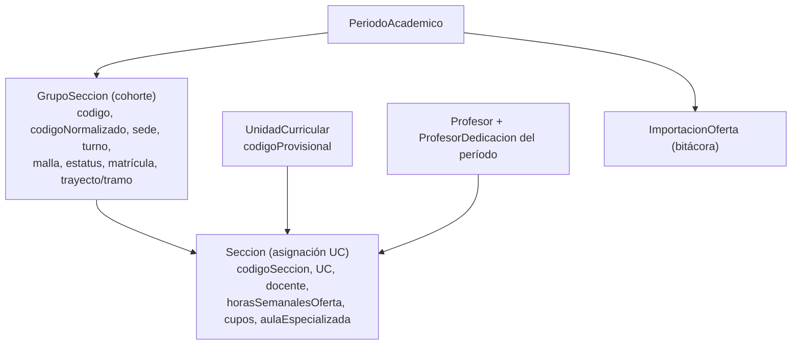
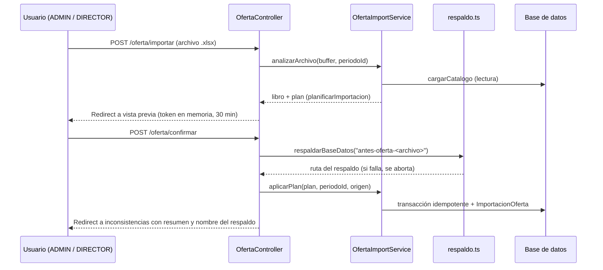

# Spec 10: Oferta de Carga Horaria, Cohortes e Inconsistencias
**Sistema Automatizado para la Asignación de Horarios Académicos (SAHAD — UBV Eje Regional Kerepakupai Vena)**

---

## 1. Propósito

Cada período, la coordinación del eje entrega el consolidado institucional **"OFERTA DE CARGA HORARIA"** en Excel (una fila por unidad curricular dictada en una sección, con su docente). SAHAD debe:

1. **Importar** ese consolidado sin escribir nada hasta que el usuario revise una vista previa.
2. **Modelar las cohortes** (secciones de estudiantes) por separado de las asignaciones UC + docente, para aplicar `H-03` por cohorte.
3. **Exportar** la oferta del período en el mismo formato de 29 columnas.
4. **Señalar las inconsistencias** que quedan después de importar (sobrecargas, déficit, vacantes, códigos provisionales, dedicaciones contradictorias) y permitir corregirlas.
5. **Respaldar** la base de datos antes de cada importación.

---

## 2. Modelo de Datos

- **`GrupoSeccion`**: única por `(periodoId, pfgId, codigoNormalizado)`. El código de la hoja (`KV BO-RC 01 A-M`) se normaliza a `KV-BO-RC-01-A-M` (`normalizarCodigoGrupo`); la última letra del patrón `KV-BO-XX-NN-L-[MTN]` permite inferir el turno.
- **`Seccion`**: una unidad curricular con su docente dentro de una cohorte. `codigoSeccion = <grupo normalizado>-<código UC>` y, si la misma UC se repite en la cohorte, se añade `-2`, `-3`… `horasSemanalesOferta` guarda las horas declaradas en la hoja y prevalece sobre $H_T + H_P$ en la carga docente y en el solver.
- **`UnidadCurricular.codigoProvisional`**: `true` cuando la hoja no traía código oficial y SAHAD lo generó (`generarCodigoUC`). Ver RC-08 (Spec 09).
- **`ImportacionOferta`**: bitácora de cada consolidado aplicado (archivo, usuario, resumen JSON del plan y de lo aplicado, dedicaciones contradictorias y filas descartadas). Es la única fuente de las dedicaciones contradictorias, que solo se conocen al leer el archivo.

---

## 3. Formato del Consolidado (29 columnas A..AC)

La fila de encabezados se detecta en las primeras 30 filas de cualquier hoja (A = `PFG`, D contiene `UNIDAD`, F empieza por `SECCION`); las filas anteriores se conservan como metadatos (título y líneas institucionales).

| Col. | Encabezado | Col. | Encabezado |
| :--- | :--- | :--- | :--- |
| A | PFG | P | ESTUDIOS DE 4TO NIVEL |
| B | TRAYECTO | Q | CANTIDAD DE ESTUDIANTES POR U.C. |
| C | TRAMO | R | MALLA |
| D | UNIDAD CURRICULAR | S | TURNO |
| E | NRO. DE HORA X UC | T | ESTATUS |
| F | SECCIÓN | U | SECCIONES POR ASESORIA |
| G | CÓDIGO U.C. /ELECTIVA | V | AULA ESPECIALIZADA |
| H | CÉDULA | W | NRO DE ENCUENTROS |
| I | NOMBRE Y APELLIDOS | X | EJE TERRITORIAL |
| J | DEDICACIÓN | Y | ÁREA ACADÉMICA |
| K | ESCALAFÓN | Z | CENTRO DE ESTUDIO |
| L | AÑO DE INGRESO | AA | EJE MUNICIPAL |
| M | AÑO DE CONCURSO | AB | NOMBRE DE ALDEA |
| N | DOCENTE/ CONDICIÓN | AC | OBSERVACIONES |
| O | PROFESIÓN | | |

---

## 4. Normalización (funciones puras, `ofertaNormalizacion.ts`)

- Comparación sin acentos, en mayúsculas y con espacios colapsados (`claveComparacion`).
- **Programa**: código de la hoja → código SAHAD (`codigoProgramaSahad`) y tipo (`PFG`, `PNF`, `PFA`, `PIU`, `IDIOMAS`). Si falta, se infiere por el nombre de la unidad.
- **Trayecto/Tramo**: romanos o números; trayecto 0–5 y tramo 0–10. Un tramo relativo al trayecto (`3 / 1`) se convierte al correlativo (`tramo 5`); si es incompatible con RC-06, se omite el tramo y se avisa. En PFA e IDIOMAS ambos quedan vacíos.
- **Dedicación, escalafón, condición, turno, malla, estatus, centro de estudio, eje municipal, aldea y aula especializada**: se mapean a los enums del dominio tolerando abreviaturas y errores de tipeo.
- **Docente**: cédula normalizada; sin cédula, se intenta identificar por nombre completo; "por asignar" o sin coincidencia deja la asignación vacante y anota el nombre en observaciones.
- **Horario en observaciones**: si las observaciones traen un horario, se extrae y se muestra en formato civil de 12 horas (no se programa automáticamente).
- **Errores que descartan la fila**: sin programa, sin nombre de unidad o sin código de sección.

---

## 5. Flujo de Importación

- **Vista previa** (`ofertaPreviewStore`): se guarda en memoria del proceso, vinculada al usuario y al período, y vence a los 30 minutos. Muestra conteos (programas, unidades, docentes, cohortes y asignaciones nuevas/existentes, vacantes, sedes nuevas), errores por fila, avisos (máx. 300), sobrecargas H-04 previstas, dedicaciones contradictorias y horarios observados.
- **Plan idempotente** (`planificarImportacion`): claves naturales: programa por código, unidad por `(PFG, código)` o, si la hoja no trae código, por nombre normalizado dentro del PFG; docente por cédula; cohorte por `(PFG, código normalizado)`; asignación por `codigoSeccion`. Reimportar el mismo archivo no duplica registros.
- **Aplicación** (`aplicarPlan`, una transacción, timeout 120 s): crea sedes, centros, programas y unidades faltantes; crea o actualiza docentes (solo con los datos que trae la hoja) y su `ProfesorDedicacion` del período con los límites de `LIMITES_DEDICACION`; crea o actualiza cohortes y asignaciones; registra la bitácora `ImportacionOferta`.
- **Dedicación contradictoria**: si una cédula aparece con dedicaciones distintas, se aplica la más frecuente y se registra el conflicto.
- **Consola**: `pnpm oferta:importar <archivo.xlsx> <codigoPeriodo> [--aplicar]` hace lo mismo; con `--aplicar` respalda primero (si la base es SQLite) y registra el origen `Consola (<usuario del sistema operativo>)`.

---

## 6. Exportación

`GET /periodos/:id/oferta/exportar.xlsx` genera el libro con los metadatos institucionales, la fila de encabezados de 29 columnas y una fila por asignación, ordenadas por programa, trayecto de la cohorte (o de la unidad; sin trayecto al final), cohorte y código de asignación. Trayecto y tramo se toman de la cohorte y, si faltan, de la unidad curricular.

---

## 7. Inconsistencias de la Oferta

`GET /periodos/:id/oferta/inconsistencias?tipo=…` (`analizarInconsistenciasOferta`, `paginarInconsistencias`):

| Tipo (`tipo`) | Criterio | Orden por defecto | Acciones en la fila |
| :--- | :--- | :--- | :--- |
| `sobrecargas` | Estado `SOBRECARGA` (H-04) | Exceso descendente | Ver asignaciones, ver horario |
| `deficit` | Estado `DEFICIT`, o `SIN_ASIGNAR` con dedicación (H-05) | Faltante descendente | Ver asignaciones, ver horario |
| `sin-dedicacion` | Tiene horas pero no dedicación en el período | — | Ver docente |
| `vacantes` | Asignación sin docente | — | Asignar docente, ver cohorte |
| `codigos-provisionales` | `codigoProvisional = true` | — | Guardar código oficial en la misma fila |
| `dedicacion-inconsistente` | De la última `ImportacionOferta` | — | Ver docente (muestra la dedicación vigente por cédula) |

- Pestañas con contador y severidad; la pestaña inicial es la primera con filas.
- Búsqueda sin acentos, orden solo por columnas válidas, `limit` máximo 100 y página acotada al rango (Spec 07).
- Caja de origen con el archivo, fecha y usuario de la última importación.
- **Exportación** `inconsistencias.xlsx`: hoja `RESUMEN` y una hoja por tipo, encabezado en la fila 1 y autofiltro.
- **Confirmar código** (`POST /periodos/:id/oferta/unidades/:unidadId/codigo`): el código debe cumplir `^[A-Z0-9][A-Z0-9.\-_]{1,29}$` y ser único en el PFG (RC-01); al guardarlo, `codigoProvisional` pasa a `false`. Roles: ADMIN, DIRECTOR y COORDINADOR_PFG (este último solo para unidades de sus programas; otra unidad responde 403 con `UnidadFueraDeAlcanceError`).
- **Alcance del coordinador** (Spec 06, sección 4): el panel de la oferta, `exportar.xlsx`, el reporte y `inconsistencias.xlsx` se limitan a sus programas (`generarReporte(periodoId, { pfgIds })`, `seccionesExportables(periodoId, pfgIds)`). Vacantes y códigos provisionales se filtran por programa; sobrecargas y déficit listan los docentes con asignaciones en sus programas, pero con su carga total real del período (H-04 es global); las dedicaciones contradictorias se limitan a esas cédulas.

---

## 8. Asignación de Docentes en Secciones

En `/periodos/:id/secciones` cada fila abre un **único modal "Asignar docente"** (en lugar de un modal por fila):
- Lista con buscador por nombre o cédula y filtro "Solo con horas disponibles".
- Para cada docente: carga actual / máximo, barra de carga y chip "Quedaría en X h" calculado con las horas de la asignación (oferta o $H_T + H_P$).
- Orden: docente actual, docentes a los que les cabe la asignación, docentes sin dedicación y por último los que se pasarían del tope.
- El botón Guardar se deshabilita si la asignación supera el máximo H-04 del docente.
- Tras guardar se vuelve a la misma página y filtros (`volver`, validado por `urlRetornoSecciones`).

En la matriz de horarios, "Por Programar" se filtra según la vista activa (`pendientesDeVista`): docente, asignación, cohorte o sede del aula seleccionada.

---

## 9. Respaldos

- `respaldarBaseDatos(prisma, { etiqueta })` (`src/core/database/respaldo.ts`) ejecuta `VACUUM INTO` (copia consistente aun en modo WAL) en `backups/sahad_AAAA-MM-DD_HH-mm-ss-SSS_<etiqueta>.db` (el directorio se puede cambiar con `SAHAD_DIRECTORIO_RESPALDOS`; las pruebas lo apuntan a una carpeta temporal) y conserva las 30 copias más recientes; solo rota archivos con ese patrón. La etiqueta se normaliza sin acentos (máx. 60 caracteres).
- Solo aplica a SQLite (`esBaseSqlite`); en PostgreSQL lanza `RespaldoNoSoportadoError` y el respaldo corresponde a `pg_dump`.
- **Automático** antes de confirmar una importación (web o consola), con la etiqueta `etiquetaRespaldoOferta(nombreArchivo)`: `antes-oferta-` más el nombre del libro sin ruta ni extensión (`OFERTA_2026-II.xlsx` → `sahad_<fecha>_antes-oferta-oferta-2026-ii.db`). Si falla, la importación no se aplica.
- **Manual**: `pnpm db:respaldo [etiqueta]`.
- **Restaurar**: detener el servidor, copiar el respaldo sobre `prisma/dev.db` y eliminar `dev.db-wal` y `dev.db-shm`.

---

## 10. Pruebas (Vitest)

| Archivo | Cobertura |
| :--- | :--- |
| `tests/domain/ofertaNormalizacion.test.ts` | Normalización de cada columna, trayecto/tramo relativo, códigos de cohorte y horarios en observaciones. |
| `tests/oferta/ofertaImportExport.test.ts` | Lectura del libro, plan idempotente (cohortes, cédulas, códigos generados, sedes) y exportación de 29 columnas. |
| `tests/oferta/ofertaAplicacion.test.ts` | Aplicación idempotente sobre base real, bitácora, códigos provisionales y reimportación por nombre. |
| `tests/oferta/ofertaInconsistencias.test.ts` | Clasificación, orden, paginación y libro de inconsistencias. |
| `tests/oferta/ofertaInconsistenciasAlcance.test.ts` | Reporte acotado a los programas del coordinador, con la carga total real del docente compartido (H-04). |
| `tests/domain/h03GrupoCohorte.test.ts` | H-03 por cohorte. |
| `tests/domain/pendientesVista.test.ts` | "Por Programar" por vista de la matriz. |
| `tests/domain/dedicacionRules.test.ts` | `calcularCargaDocente` y `urlRetornoSecciones`. |
| `tests/database/respaldo.test.ts` | Nombre, `etiquetaRespaldoOferta`, rotación y copia `VACUUM INTO`. |
| `tests/acceptance/oferta.steps.test.ts` | Regla "Oferta de carga horaria" de la Spec 05: importación web con respaldo y bitácora, reimportación sin duplicados y código provisional confirmado. |
| `tests/acceptance/coordinador.steps.test.ts` | Código de una unidad de otro programa rechazado (403). |
